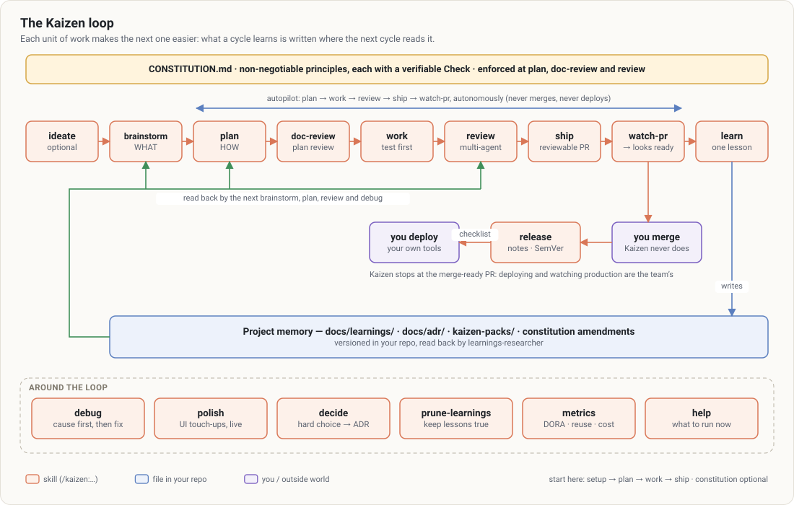

# Dojo

A Claude Code plugin marketplace, providing an AI-assisted SDLC (Kaizen, converging on Addy Osmani's Agent Skills, also shipped here), motion design as code (Motion Studio) and presentation decks as HTML (Slide Studio).

> **Kioku** (the guarded knowledge vault) is no longer distributed here: it is a self-contained application, installed
> from [its own repository](https://github.com/Lingelo/kioku) (`git clone`, then `kioku install`). If you installed
> `kioku@dojo`, follow its update guide to migrate your vault, then `/plugin uninstall kioku@dojo`.

## Available plugins

| Plugin | Description | Components |
|---|---|---|
| [**kaizen**](plugins/kaizen/README.md) | The engine around Addy Osmani's [agent-skills](https://github.com/addyosmani/agent-skills) (MIT), **embedded**: one plugin, its whole workflow under the `/kaizen:` prefix (`spec` → `plan` → `build` → `test` → `review` → `ship`), and what they do not do — a quality gate that keeps a turn open while checks are red, the review recorded by itself and required before any push, no secret committed, learnings brought back when a spec, a plan or a file they cover is touched, the PR followed to "looks ready" (`/kaizen:watch`), DORA approximations, friction and the cost of each feature or fix (`/kaizen:metrics`) | 4 skills + agent-skills' 25, 15 commands, 4 reviewer personas, 8 hook registrations, zero-dependency CLI |
| [**motion-studio**](plugins/motion-studio/README.md) | Motion design as code: HTML/CSS/SVG/Canvas → MP4/WebM/GIF frame by frame, synced sound, voice-over and subtitles (Playwright + ffmpeg) | Skill, scripts |
| [**slide-studio**](plugins/slide-studio/README.md) | Presentation decks as one HTML file: 19 layouts, 3 themes (`ink`, `paper`, `kaizen`) + brand tokens, presenter mode (steps, notes, overview), every slide audited in headless Chromium (overflow, collisions, contrast, density), export to PDF/PNG/contact sheet | Skill, scripts |

Everything is in English. Claude still answers in the language you write in.

## Installation

### 1. Add the marketplace

```bash
/plugin marketplace add Lingelo/dojo
```

Or interactively:
```bash
/plugin
# Go to the "Marketplaces" tab > "Add marketplace"
# Enter Lingelo/dojo
```

> **Installed under the marketplace's previous name?** Remove it (`/plugin marketplace remove <old name>`),
> add `Lingelo/dojo`, reinstall the plugins, and use `@dojo` in `enabledPlugins` / `extraKnownMarketplaces`.

### 2. Install the plugins

**Interactive (recommended):**
```bash
/plugin
# Go to the "Discover" tab and select the plugins to install
```

**Direct installation:**
```bash
/plugin install motion-studio@dojo
/plugin install kaizen@dojo
/plugin install slide-studio@dojo
```

## Team configuration

Add to your project's `.claude/settings.json` to configure every team member automatically:

```json
{
  "extraKnownMarketplaces": {
    "dojo": {
      "source": {
        "source": "github",
        "repo": "Lingelo/dojo"
      }
    }
  },
  "enabledPlugins": {
    "kaizen@dojo": true,
    "motion-studio@dojo": true,
    "slide-studio@dojo": true
  }
}
```

## Managing plugins

| Command | Description |
|---|---|
| `/plugin` | Open the interactive plugin manager |
| `/plugin install name@marketplace` | Install a plugin |
| `/plugin uninstall name@marketplace` | Remove a plugin |
| `/plugin enable name@marketplace` | Enable a disabled plugin |
| `/plugin disable name@marketplace` | Disable without removing |
| `/plugin marketplace list` | List the registered marketplaces |
| `/plugin marketplace update` | Update the metadata |

## Usage examples

### Kaizen

<a href="media/kaizen/kaizen-presentation.mp4"></a>



```bash
/kaizen:setup                                   # config, verification commands, guard rails; then where you stand
/kaizen:ideate exports for accountants          # optional: a vague idea clarified, stress-tested, narrowed
/kaizen:spec orders CSV export                  # WHAT to build → SPEC.md (agent-skills); matching learnings come back
/kaizen:plan                                    # HOW → tasks/plan.md, tasks/todo.md
/kaizen:build auto                              # test first, task by task; the quality gate holds red turns
/kaizen:review                                  # five-axis review, recorded: the push is allowed
/kaizen:ship                                    # go/no-go, then push and open the PR
/kaizen:watch                                   # review comments, CI, branch — until "looks ready"; you merge
/kaizen:learn                                   # the lesson, brought back by the next spec, plan or edit
/kaizen:metrics                                 # are we improving, and at what cost
# at any time: /kaizen:debug (root cause) · /kaizen:adr (decision) · /kaizen:security (audit)
#              /kaizen:doubt (stress-test a plan) · /kaizen:migrate (deprecation, migration)
```

Documentation: [getting started](plugins/kaizen/docs/getting-started.md) ·
[guides](plugins/kaizen/docs/README.md) ·
[configuration](plugins/kaizen/docs/reference/configuration.md) ·
[troubleshooting](plugins/kaizen/docs/troubleshooting.md) ·
[how it works](plugins/kaizen/docs/README.md#how-it-works) ·
[CLI reference](plugins/kaizen/docs/reference/cli.md).

### Motion Studio
```bash
/motion-video 8-second 16:9 teaser for our API launch, dark style, orange accent
```
Storyboard → HTML/CSS/SVG/Canvas composition → control stills → frame-by-frame MP4 render (virtual
clock, motion blur, supersampling) with synced sound effects, music, voice-over and subtitles.
Dependencies (Playwright, Chromium, ffmpeg) installed automatically on first use.

### Slide Studio
```bash
/slides 10-minute talk for the team offsite on our move to smaller pull requests, paper theme
```
Brief → storyline (one assertion title per slide, a layout per message) → deck scaffolded from the
themed template → every slide audited at its real size (`slides.mjs check`) → contact sheet, PNGs and PDF.
The HTML file presents itself in any browser (← / →, `O` overview, `N` notes, `F` fullscreen).
Writing a deck needs nothing; Playwright and Chromium are installed automatically for check and export.

## Structure

```
dojo/
├── .claude-plugin/
│   └── marketplace.json      # Marketplace registry
├── .github/workflows/        # CI (kaizen.yml: Kaizen tests on Linux, macOS, Windows; slide-studio.yml: same for Slide Studio; sync-agent-skills.yml: proposes agent-skills updates as pull requests)
├── docs/learnings/           # This repo's own learnings (Kaizen format)
├── plugins/
│   ├── kaizen/               # The engine around agent-skills: 4 skills, generated commands and agents, hooks, zero-dependency CLI
│   │   └── agent-skills/     # Addy Osmani's agent-skills, embedded: a copy of addyosmani/agent-skills, proposed by pull request by .github/workflows/sync-agent-skills.yml
│   ├── motion-studio/        # Motion design videos from HTML (Playwright + ffmpeg)
│   └── slide-studio/         # Presentation decks as one HTML file, audited and exported (Playwright)
├── CLAUDE.md
└── README.md
```

## Contributing

1. Create a new plugin in `plugins/your-plugin/`
2. Add `.claude-plugin/plugin.json` with the metadata (`name`, `version`, `description`, `author`)
3. Add commands, agents, skills or hooks as needed
4. Register it in `.claude-plugin/marketplace.json`
5. Add a `README.md` documenting your plugin, in English

Test suites: `node --test plugins/kaizen/tests/*.test.mjs` (Kaizen) and
`node --test plugins/slide-studio/tests/*.test.mjs` (Slide Studio).

## License

MIT
