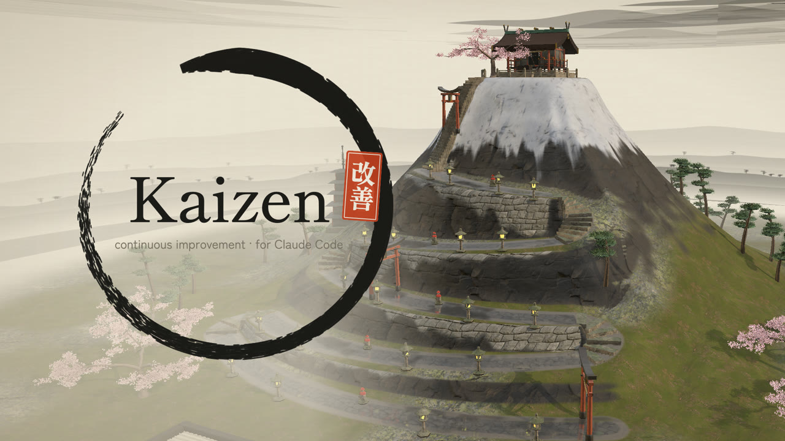
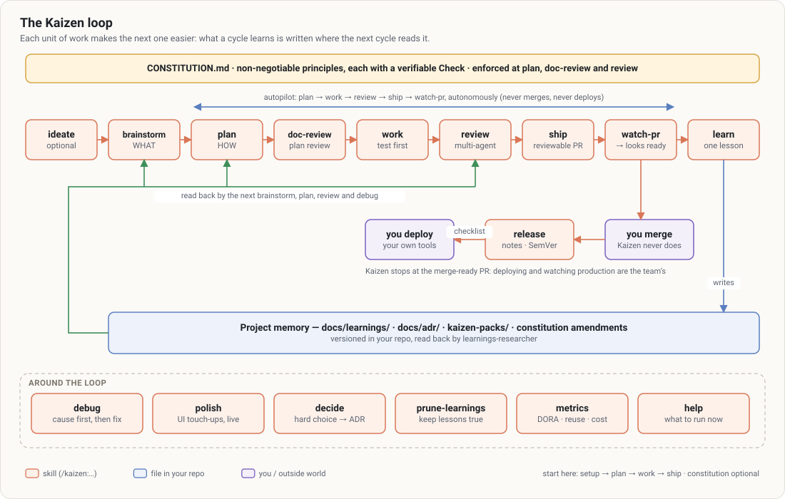

# Kaizen Plugin

**Addy Osmani's agent-skills, made to hold — and each unit of work makes the next one easier.**

<a href="../../media/kaizen/kaizen-presentation.mp4"></a>

*80-second presentation with voice-over: [watch the video (MP4)](../../media/kaizen/kaizen-presentation.mp4)
· [subtitles](../../media/kaizen/kaizen-presentation.srt). Reproducible source:
[media/kaizen/source/](../../media/kaizen/source/README.md), rendered with the `motion-studio` plugin.*

Since 6.0, Kaizen is **the engine around [agent-skills](https://github.com/addyosmani/agent-skills)**,
Addy Osmani's engineering workflows for coding agents, shipped next to it in the dojo marketplace.

- **agent-skills does the work.** Its commands are available under Kaizen's prefix: `/kaizen:spec`,
  `/kaizen:plan`, `/kaizen:build`, `/kaizen:test`, `/kaizen:review`, `/kaizen:ship`,
  `/kaizen:constraints`, `/kaizen:webperf`, `/kaizen:code-simplify`. Each step has an exit criterion,
  a table of rationalizations to refuse, and evidence to show.
- **Kaizen makes it hold**, with hooks you never have to run:
  - Claude cannot end a turn with red checks after editing code;
  - a branch is not pushed without a review, unless you say so;
  - a commit carrying a key or token is refused.
- **Kaizen remembers.** Learnings in `docs/learnings/` come back by themselves when the next spec or plan
  is written, or when a file they are about is edited.
- **Kaizen follows the PR and measures.** `/kaizen:watch` drives the PR to "looks ready" (it never
  merges); `/kaizen:metrics` and `kaizen cost` say whether things improve, and at what cost.

DORA 2025 (confirmed by its 2026 ROI report) shows that AI **amplifies**: it raises throughput, but also
instability, except for teams with clear principles, **small batches** and real feedback.
agent-skills writes those disciplines down; Kaizen enforces them and learns from each cycle.



> Built on Addy Osmani's [agent-skills](https://github.com/addyosmani/agent-skills) (MIT), shipped
> unmodified in `plugins/agent-skills/`. The learning loop and PR tracking come from Every's
> [Compound Engineering](https://github.com/EveryInc/compound-engineering-plugin) (MIT, see
> [LICENSE](LICENSE)); the delivery practices from [DORA](https://dora.dev/research/). Kaizen adds
> hook-enforced gates, a zero-dependency CLI, tests and end-to-end evals.

## Language

Kaizen is written in English: skills, CLI and hook messages, documentation. Claude still **talks to you
in your language**, and the learnings and PR replies it writes follow `language` in
`.kaizen/config.json` (`auto` = the language of the conversation).

## Documentation

- **[Getting started](docs/getting-started.md)** — install, then a first feature from spec to merge
- **[Guides](docs/README.md#guides)** — [setup](docs/guides/setup.md), [learn](docs/guides/learn.md), [metrics](docs/guides/metrics.md), [watch](docs/guides/watch.md)
- **[How it works](docs/README.md#how-it-works)** — [Kaizen around agent-skills](docs/concepts/the-loop.md), [gates and hooks](docs/concepts/gates.md), [learnings](docs/concepts/learnings.md), [metrics](docs/concepts/metrics.md)
- **Reference** — [CLI](docs/reference/cli.md) · [configuration](docs/reference/configuration.md) · [state and files](docs/reference/state-and-files.md)
- [Migrating to 6.0](docs/migrating-to-6.md) · [Troubleshooting](docs/troubleshooting.md) · [Positioning](docs/positioning.md) · [Changelog](CHANGELOG.md)

## Installation

```json
{
  "extraKnownMarketplaces": { "dojo": { "source": { "source": "github", "repo": "Lingelo/dojo" } } },
  "enabledPlugins": { "kaizen@dojo": true, "agent-skills@dojo": true }
}
```

Both plugins, in the versioned `.claude/settings.json`: `/kaizen:setup` writes it for you
(`node $K install settings`). Prerequisites: Node ≥ 18 and git; `gh` for pull requests. No npm
dependency.

## Start here

| # | Command | What happens |
|---|---|---|
| 1 | `/kaizen:setup` | once per repo: config, the verification commands the quality gate runs, both plugins declared, guard rails checked |
| 2 | `/kaizen:spec <what to build>` | agent-skills interviews you and writes `SPEC.md`; Kaizen adds the matching learnings to the context |
| 3 | `/kaizen:plan` | small tasks with acceptance criteria and files in `tasks/todo.md` |
| 4 | `/kaizen:build` (or `/kaizen:build auto`) | one task at a time, test first, one commit per task; the quality gate holds every turn that edits code |
| 5 | `/kaizen:review` | five-axis review; Kaizen records it, so the push is allowed |
| 6 | `/kaizen:ship`, then `/kaizen:watch` | go/no-go checklist, the PR opened, then followed until it looks ready |

Then **you merge**, and `/kaizen:learn` keeps what was not obvious. Lost? `/kaizen:setup` says where the
repo stands and what to run next.

## The commands

**agent-skills' commands, under Kaizen's prefix** (copied unchanged from
`plugins/agent-skills/.claude/commands/` by `scripts/aliases.mjs`; they run its skills, so
`agent-skills@dojo` must be enabled; `/agent-skills:<name>` still works too):

| Command | What it does |
|---|---|
| `/kaizen:spec` | spec-driven development: objective, commands, structure, style, tests, boundaries Always / Ask first / Never, success criteria |
| `/kaizen:plan` | small verifiable tasks with acceptance criteria, files and dependencies (`tasks/plan.md`, `tasks/todo.md`) |
| `/kaizen:build` | incremental implementation, test first, one commit per task; `auto` runs the whole plan after one approval |
| `/kaizen:test` | test-driven development; for a bug, the Prove-It pattern (a failing reproduction first) |
| `/kaizen:review` | five-axis review: correctness, readability, architecture, security, performance |
| `/kaizen:ship` | pre-launch checklist with specialist personas, go/no-go |
| `/kaizen:constraints` | the quality bar as `CONSTRAINTS.md`: floor, thresholds with their command, ratchets, dated exceptions |
| `/kaizen:webperf` | web performance audit (Core Web Vitals) |
| `/kaizen:code-simplify` | simplification without changing behavior |

**Kaizen's own skills** (what agent-skills does not do):

| Skill | What it does |
|---|---|
| `/kaizen:setup [check]` | installs Kaizen in a repo, checks the guard rails, says where the repo stands and what to run next |
| `/kaizen:learn [harvest \| prune]` | one durable learning per problem in `docs/learnings/`, every lesson of a branch, or the corpus pruned |
| `/kaizen:metrics [90d \| cost <item>]` | DORA approximated from git and GitHub, learnings reuse, friction, cost per feature or fix |
| `/kaizen:watch [PR] [4h]` | follows a PR until it looks ready: feedback first, CI repaired, branch updated only when behind; never merges |

## What guarantees quality

| Guarantee | How | When |
|---|---|---|
| **No end of turn on red checks** | `quality-gate.mjs`, a Stop hook | on by itself once the session edits a code file; off when green; 3 blocks at most, then Claude must say what is still red |
| **No unreviewed push** | `review-gate.mjs`, a PreToolUse hook; `review-hooks.mjs` records agent-skills' review | the review skill (`/kaizen:review`) or the `code-reviewer` persona (`/kaizen:ship`); verdict read from what it wrote: a Critical finding blocks the same tree |
| **Skipping the review is yours** | Claude asks, the review first; you confirm in Claude Code's own prompt | `review.require_before_push`: `true` (default), `false` |
| **No secret committed** | `secret-gate.mjs`, a PreToolUse hook | every `git commit` Claude runs, in every repo; `--no-verify` refused |
| **Learnings read back** | `post-edit.mjs`, a PostToolUse hook | `SPEC.md` or `tasks/` written; a file a learning names in `files:` edited |
| **Guard rails visible** | `kaizen doctor` | plugin and agent-skills declared, hooks firing, branch reviewed, floor guard wired |

agent-skills' own guard against a weakened bar — its **floor guard** (skipped tests, silenced checks,
stubs, lowered thresholds) — is installed in your repository by `/kaizen:constraints`; `kaizen doctor`
reports whether it runs.

## Files in the target repo

```
.kaizen/config.json        configuration (config.local.json = personal override, ignored by git)
.kaizen/state/             local state: gate, reviews, PR tracking, ledger, friction — ignored by git
docs/learnings/            learnings, one per file (validated frontmatter)
SPEC.md, tasks/, CONSTRAINTS.md   agent-skills' files, read by Kaizen
```

```json
{
  "docs_root": "docs",
  "language": "auto",
  "verify": { "test": "pnpm vitest run", "lint": "pnpm eslint ." },
  "gate": { "max_blocks": 3, "targeted": { "lint": "pnpm eslint {files}" } },
  "review": { "require_before_push": true, "max_unreviewed_lines": 80 },
  "pr": { "max_lines": 400 }
}
```

Every key: [configuration](docs/reference/configuration.md).

## Reference

### CLI

`K="${CLAUDE_PLUGIN_ROOT}/scripts/kaizen.mjs"` — zero dependency, used by the skills and the hooks.

```bash
node $K status [--json]                        # where the repo stands, next command
node $K root                                   # deliverable paths
node $K init [--docs-root d] [--language en]   # .kaizen/config.json and docs/learnings/
node $K config                                 # effective configuration
node $K detect                                 # stack and verification commands
node $K verify [--only test,lint] [--json]     # the checks (exit 1 if red)
node $K doctor [--in-skill] [--json] [--strict]   # are the guard rails on?
node $K install settings                       # both plugins declared for every clone
node $K gate status | off                      # this session's quality gate
node $K review status | check                 # review state, push decision
node $K secrets scan [--staged | --base <ref>] # possible secrets in the changes
node $K learnings search <words…> | validate | list [--retire] | stats
node $K metrics [--since 90d] [--no-github]
node $K cost [item | current] [--since 90d]    # what each feature or fix cost
node $K pr snapshot|watch|mark|threads|reply|resolve|comment|update-branch|overlap …
```

Exit codes: 0 = OK, 1 = red check (verify, secrets scan, review check…), 2 = usage error. Every
command: [CLI reference](docs/reference/cli.md).

### Hooks

| Event | Script | Role |
|---|---|---|
| `SessionStart` | `scripts/review-hooks.mjs --heartbeat` | records that Kaizen's hooks run here, for `kaizen doctor` |
| `PreToolUse` (Bash) | `scripts/secret-gate.mjs` | refuses a `git commit` adding a key or token, and `--no-verify`; active in every git repo |
| `PreToolUse` (Bash, Write, Edit…) | `scripts/review-gate.mjs` | refuses `git push` of an unreviewed branch and direct writes to Kaizen's review state; a push without a review goes through Claude Code's prompt |
| `PostToolUse` (Write, Edit…) | `scripts/post-edit.mjs` | turns the quality gate on when code is edited; reads learnings back |
| `PostToolUse` (Agent, Task, Skill) | `scripts/review-hooks.mjs --evidence` | records agent-skills' review (persona at once, skill at the end of the turn) |
| `Stop` | `scripts/quality-gate.mjs` | blocks the end of the turn while the checks are red |
| `Stop` | `scripts/review-hooks.mjs --stop` | reads the verdict of the review the turn ran |
| `Stop` | `scripts/ledger-hook.mjs` | charges the turn's tokens to the work item, for `kaizen cost`; never blocks |

### Environment variables

| Variable | Role |
|---|---|
| `CLAUDE_PLUGIN_ROOT` | the plugin's folder, set by Claude Code |
| `CLAUDE_CONFIG_DIR` | where `doctor` looks for your user settings (default `~/.claude`) |
| `KAIZEN_GH` | binary to use instead of `gh` (tests) |

## Quality of the plugin itself

```bash
node --test plugins/kaizen/tests/*.test.mjs    # unit, CLI, gates, hooks, PR (fake gh), contracts
node plugins/kaizen/evals/run.mjs              # end-to-end evals (claude -p, costly)
```

- **Contract tests** check that there are four skills in agent-skills' anatomy (rationalizations, red
  flags, verification checklist), that the `/kaizen:` commands are exact copies of agent-skills', that
  every `/kaizen:` and `agent-skills:` name exists, that no page sends anyone to a removed command, that
  this README lists every CLI command and hook, that every page is indexed and every link and anchor
  resolves, and that every configuration key is documented.
- **Diagram tests** hold the SVGs to `docs/media/source/diagrams.mjs` (edit the generator, then run it)
  and to `hooks.json`.
- **CI** (`.github/workflows/kaizen.yml`): Linux, macOS and Windows, Node 18 and 22.
