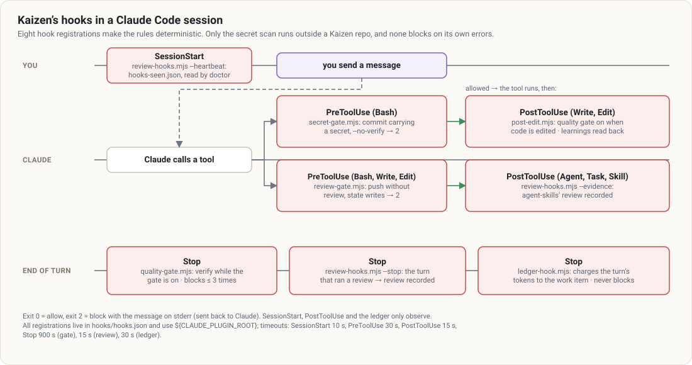
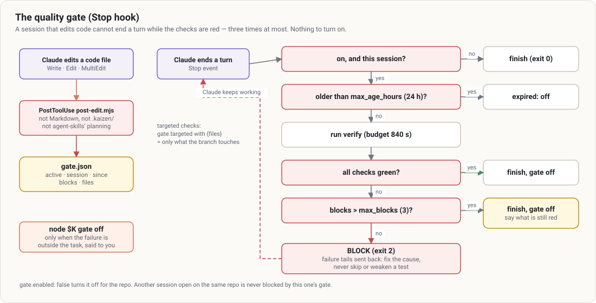
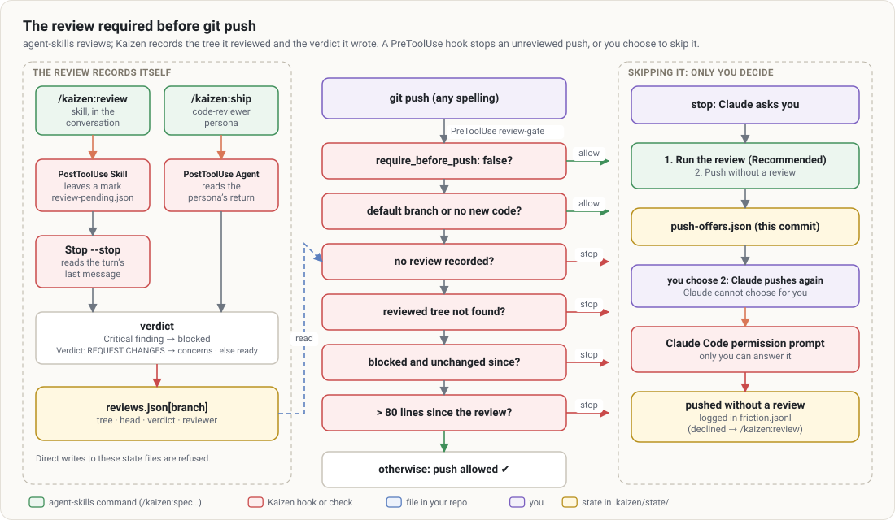

# Gates and hooks

Kaizen's guarantees are **hooks**: Claude Code runs them on its own, whatever the agent intends. None of
them needs a command; each can be waived only where it says so.

Common rules:

- **Inactive outside a Kaizen repository** (no `.kaizen/config.json`), except the secret scan, which
  runs in every git repository: a leaked key costs the same whether Kaizen was initialized or not.
- **Exit 0 allows, exit 2 blocks** with the message on stderr, sent back to Claude.
- **A broken hook never blocks the work**: an internal error lets the command through, with a message.

## The quality gate

As soon as the session edits a code file (`Write`, `Edit`, `MultiEdit`, `NotebookEdit` — not Markdown, not
`.kaizen/`, not agent-skills' planning files), `post-edit.mjs` turns the gate on for **this session**. At
the end of every turn, the Stop hook runs the verification:

- green → the turn ends and the gate turns itself off;
- red → the turn is blocked and the failures' last lines go back to Claude, which keeps working — fixing
  the cause, never skipping or weakening a test;
- red after `gate.max_blocks` (3) attempts → the turn ends anyway and Claude must tell you what is
  still red; the gate turns off.

The commands are `verify` in `.kaizen/config.json` (or what `node $K detect` finds). Slow suites:
`gate.targeted` runs a command on the files the branch touches only (`{files}`). The checks fit within
`gate.budget_seconds`. A gate older than `gate.max_age_hours` expires. Another session open on the same
repository is never blocked by this one's gate.

When the failure is outside the task (already red on `main`), `node $K gate off` lifts it — Claude must
say why. `"gate": { "enabled": false }` turns it off for the repository.

## The review before push

The review is agent-skills'. Kaizen records it **without asking the agent to declare anything**:

- `/kaizen:review` loads agent-skills' `code-review-and-quality` skill through the Skill tool: the
  PostToolUse hook leaves a mark, and at the end of the turn the Stop hook reads the review Claude wrote;
- `/kaizen:ship` launches agent-skills' `code-reviewer` persona: its return is read at once.

The verdict comes from the text: a non-empty **Critical** section or a `Critical:` finding → `blocked`;
`Verdict: REQUEST CHANGES` → `concerns`; otherwise `ready`. Kaizen records the **tree** the review saw
(committed and uncommitted) in `.kaizen/state/reviews.json`.

At `git push` (any spelling: `/usr/bin/git push`, `git -C . push`, `HEAD:main`…), the PreToolUse hook
decides, first match wins:

| Situation | Decision |
|---|---|
| `review.require_before_push: false` | allowed |
| default branch, or no code change on the branch | allowed |
| no review recorded | stopped |
| the reviewed tree cannot be found (history rewritten) | stopped |
| last review `blocked` and nothing changed since | stopped |
| more than `review.max_unreviewed_lines` (80) changed since the review | stopped |
| otherwise | allowed |

**Skipping the review is yours.** With `require_before_push: "ask"` (default), the first push of a commit
is stopped and Claude asks you, the review as the first option. If you choose to push without it,
Claude pushes again and **Claude Code's own permission prompt** asks you to confirm — Claude cannot
answer it. With `true`, the push is refused and only `review waive --reason "…"` lifts it, confirmed by
you (a question then the prompt, or with `approvals: "code"` the code `kaizen waive <code>` you type).
In bypass-permissions mode nothing can ask you: the skip is refused.

Direct writes to Kaizen's state (`reviews.json`, `review-pending.json`, `waivers.json`, `push-offers.json`,
`confirm-asks.json`, `hooks-seen.json`) and manual calls of `review-hooks.mjs` are refused.

## No secret committed

`secret-gate.mjs` scans what a `git commit` run by Claude is about to commit (index, plus what a
`git add` in the same command or `commit -a` brings in) for about thirty key and token formats, and
refuses the commit — and `--no-verify`. False positives: `secrets.ignore` (path globs). Check by hand:
`node $K secrets scan [--staged | --base <ref>]`.

agent-skills' **floor guard** (from `/kaizen:constraints`) is the complement for the other ways a bar
gets lowered — skipped or deleted tests, silenced checkers, stubs, thresholds edited down. It lives in
your repository (pre-commit and CI); `kaizen doctor` reports whether it is wired.

## Without the plugin: git hooks

Hooks only exist when Claude Code loads the plugin. `node $K install git-hooks` writes
`.githooks/pre-push` (the same review decision, for every branch a push updates, at the pushed commit)
and `.githooks/pre-commit` (staged secrets), and sets `core.hooksPath`. They run a pinned CLI
(`git config kaizen.cli`, `$KAIZEN_CLI`, or the dojo marketplace's plugin cache only — each must be
Kaizen by its `plugin.json`) and refuse when it is missing. From your own terminal in `"ask"` mode, the
pre-push only reminds; from Claude Code, it lets through only the push you were asked about.

An existing hook is never overwritten: the output gives the line to chain into it. Each clone wires
them once: `git config core.hooksPath .githooks`.

## Doctor

`node $K doctor` (run first by `/kaizen:setup`) says whether the guard rails are actually on:

| Check | ⚠ when |
|---|---|
| `config` | no `.kaizen/config.json`: every gate but the secret scan is off |
| `upgrade` | a Kaizen update still asks something of this repo ([`kaizen upgrade`](../reference/cli.md#upgrade---apply---json)) |
| `plugin_declared` | `.claude/settings.json` does not declare `kaizen@dojo` and its marketplace: clones run without Kaizen |
| `agent_skills` | `agent-skills@dojo` is not enabled: the workflow commands are missing and no review can record itself |
| `floor_guard` | `CONSTRAINTS.md` exists but its floor guard runs from no hook nor CI |
| `hooks` | in a skill, no Kaizen hook has fired in this repo: every gate is off in this session |
| `git_hooks` | present but not wired, not executable, not Kaizen's, or with an older CLI lookup |
| `verify` | no verification command: the quality gate has nothing to run |
| `review`, `pushed` | the branch, or what was already pushed, has no recorded review |

Each line carries its fix. `--strict` exits 1 on any ⚠.
