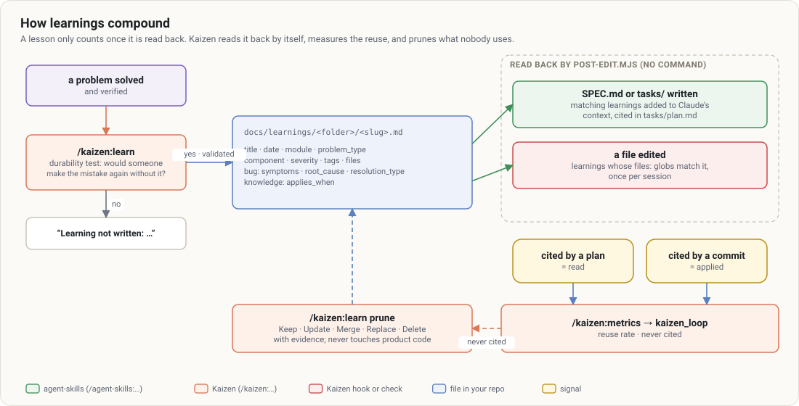

# Learnings

A learning is a lesson a future developer would otherwise pay for again. It lives in
`docs/learnings/<folder>/<slug>.md`, one per file, versioned with the code, and it **comes back by
itself**: Kaizen's hooks add it to Claude's context at the moments it matters.

## The durability test

A learning only belongs if it carries reasoning the final code, tests, types and comments do not make
obvious, and whose loss would bring the problem back or redo a costly investigation:

> If this document disappeared, would someone reading the final code make the mistake again, or redo
> the same investigation?

Typically yes: a surprising root cause, an API or framework trap, what **did not** work and why, a
decision costly to reconstruct. Typically no: a typo, a fix the test and the commit message explain, a
description of what the code already says. `/kaizen:learn` applies the test and, when it fails, writes
nothing and says why.

## The format

Frontmatter validated by `node $K learnings validate` (contract:
[`references/learnings-schema.md`](../../references/learnings-schema.md)):

| Field | |
|---|---|
| `title`, `date` (YYYY-MM-DD), `module`, `component`, `severity` | required |
| `problem_type` | required; picks the track — **bug** (`build_error`, `test_failure`, `runtime_error`, `performance_issue`, `database_issue`, `security_issue`, `ui_bug`, `integration_issue`, `logic_error`) or **knowledge** (`best_practice`, `documentation_gap`, `workflow_issue`, `developer_experience`, `architecture_pattern`, `design_pattern`, `tooling_decision`, `convention`) |
| `symptoms` (1 to 5), `root_cause`, `resolution_type` | required on the bug track |
| `applies_when` (≤ 5) | knowledge track |
| `tags` (≤ 8) | words the next request will use |
| `files` | path globs the lesson is about (`src/exports/**`): editing a matching file brings it back |
| `retire_when` | for a lesson tied to a state **outside** the repo (an open upstream bug): the change that retires it and a check that runs without changing the repo |

Templates: [`learning-bug.md`](../../templates/learning-bug.md),
[`learning-knowledge.md`](../../templates/learning-knowledge.md).

## How they come back

No skill has to remember to search. `post-edit.mjs` (PostToolUse on file edits):

- **`SPEC.md`, `docs/SPEC.md`, `tasks/plan.md` or `tasks/todo.md` written** → the learnings matching its
  headings (title and tags weigh 4, module and components 3, symptoms and root cause 2, body 1) are added
  to Claude's context, with the instruction to cite the ones that apply in `tasks/plan.md`. Once per
  version of the file.
- **A file a learning names in `files:` edited** → that learning is added to the context, once per
  session.

By hand: `node $K learnings search <words…>`.

## Read, applied, never cited

`/kaizen:metrics` (`kaizen_loop`) counts a learning as **read** when a plan touched in the window cites it
(`SPEC.md`, `tasks/`), **applied** when a commit message on the default branch
cites it, and lists those **never cited** — candidates for `/kaizen:learn prune`. A learning nobody reads
back closes no loop.

## Pruning

`/kaizen:learn prune` checks each candidate against the current code — paths and symbols still there,
`retire_when` met, the same lesson elsewhere — and decides with the evidence: keep, update, merge,
replace or delete. It asks before deleting or merging and never touches product code.
