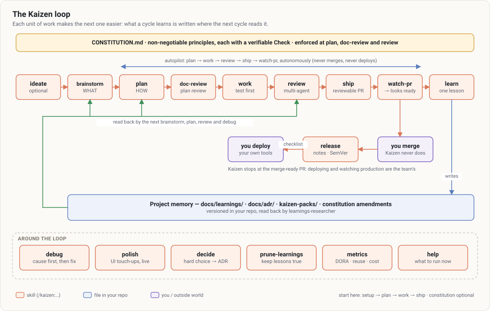
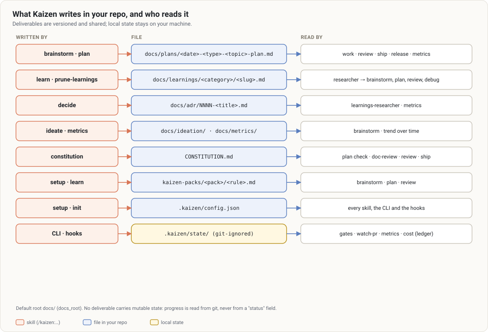

# Kaizen around agent-skills

> Each unit of work must make the next one easier.

## Who does what

AI coding agents take the shortest path to "done" and skip the invisible senior-engineer work: the
spec, the tests, the review, the scope. Two complementary answers:

| | agent-skills (Addy Osmani) | Kaizen |
|---|---|---|
| How | **written discipline**: each skill is a process with exit criteria, a table of excuses and their rebuttals, red flags, evidence to show | **enforced discipline**: hooks that block, whatever the agent intends |
| Covers | spec, plan, build, test, review, ship, constraints, simplification, performance, and a skill per concern (security, API design, observability…) | the gates around that work, the memory between cycles, the PR until it is ready, the measure |
| Lives in | `plugins/agent-skills/` (a copy, synced from upstream by pull request, never edited) | `plugins/kaizen/` |

Kaizen never redoes what agent-skills does. It has four skills of its own and runs
agent-skills' commands under its prefix.

## The commands

| Step | Command | Done by | Output |
|---|---|---|---|
| Set up (once) | `/kaizen:setup` | Kaizen | `.kaizen/config.json`, both plugins declared, guard rails checked |
| Quality bar (optional, once) | `/kaizen:constraints` | agent-skills | `CONSTRAINTS.md`, its floor guard installed |
| Idea (optional) | `/kaizen:ideate` | agent-skills' `interview-me` and `idea-refine` | one refined concept, the `/kaizen:spec` to run |
| What | `/kaizen:spec` | agent-skills | `SPEC.md` |
| How | `/kaizen:plan` | agent-skills | `tasks/plan.md`, `tasks/todo.md` |
| Build | `/kaizen:build` (`auto`) | agent-skills | one commit per task, tests first |
| Prove | `/kaizen:test` | agent-skills | a failing test first; Prove-It for a bug |
| Check | `/kaizen:review` | agent-skills, recorded by Kaizen | five-axis review, the push allowed |
| Launch | `/kaizen:ship` | agent-skills | go/no-go checklist |
| Follow | `/kaizen:watch` | Kaizen | the PR driven to "looks ready" |
| **You merge** | — | you | Kaizen never merges |
| Learn | `/kaizen:learn` | Kaizen | one durable lesson in `docs/learnings/` |
| Measure | `/kaizen:metrics` | Kaizen | DORA approximated, learnings reuse, friction, cost |

Around them: `/kaizen:code-simplify` and `/kaizen:webperf` (agent-skills). The `/kaizen:` commands of
agent-skills are exact copies of its own (`commands/`, generated by `scripts/aliases.mjs` and refreshed
with each agent-skills update); `/agent-skills:<name>` works too.

## What runs without being asked

Eight hook registrations ([Gates and hooks](gates.md)):

- editing a code file turns the **quality gate** on: no end of turn on red checks;
- agent-skills' **review records itself**, and an unreviewed branch is not pushed without your say;
- a **commit carrying a secret** is refused;
- writing `SPEC.md` or `tasks/`, or editing a file a learning is about, **brings the learnings back**;
- each turn's tokens are **charged to the work item** (`kaizen cost`).

## Who decides what

| Decision | Who |
|---|---|
| What to build, the scope, the trade-offs | **you**, through agent-skills' interview and spec |
| How to build it, within the plan | Claude, following agent-skills' process |
| Whether checks pass, whether a review happened, whether a push may go | **deterministic gates** (Kaizen's hooks), not Claude's word |
| Skipping the review | **only you**: Claude asks (the review first), you confirm in Claude Code's prompt |
| Merging, deploying | **only you**, with your own tools |

## Knowing where you are

`/kaizen:setup` (backed by `node $K status`) reads the repository and names the next command, first
match wins:

1. Kaizen not initialized → `/kaizen:setup`.
2. The quality gate stopped the last turn → make the checks green.
3. Tasks left in `tasks/todo.md` → `/kaizen:build`; a spec without tasks → `/kaizen:plan`.
4. Code changed on a branch (the spec and `tasks/` do not count): not reviewed → `/kaizen:review`;
   reviewed and committed → `/kaizen:ship`; reviewed and pushed → `/kaizen:watch`.
5. Otherwise → `/kaizen:spec <what to build>`.

## Where everything lives

No file carries a mutable "status": progress is read from git and from agent-skills' task checkboxes.
Every file: [State and files](../reference/state-and-files.md).
