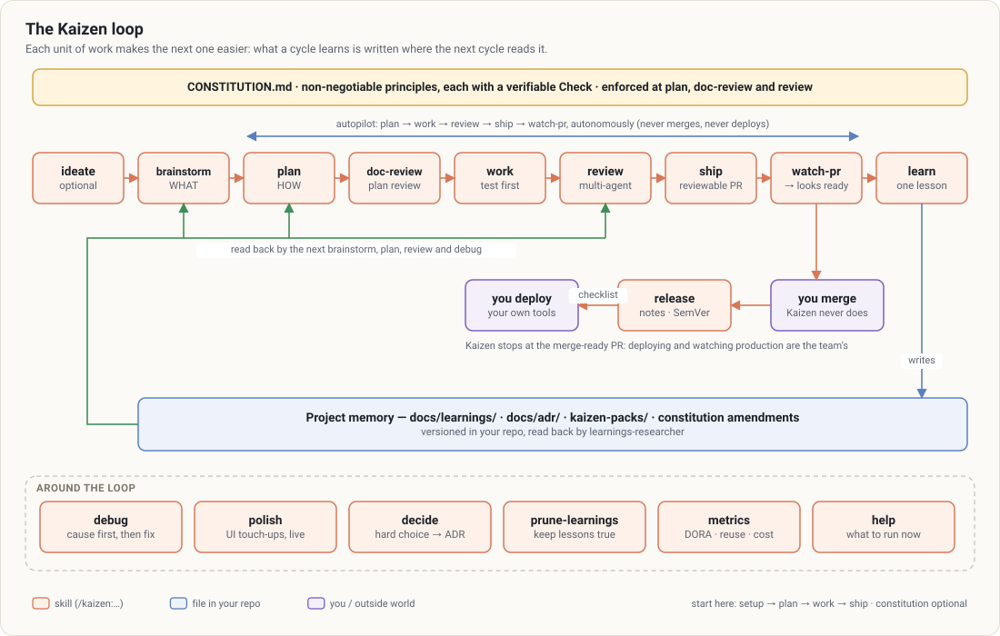
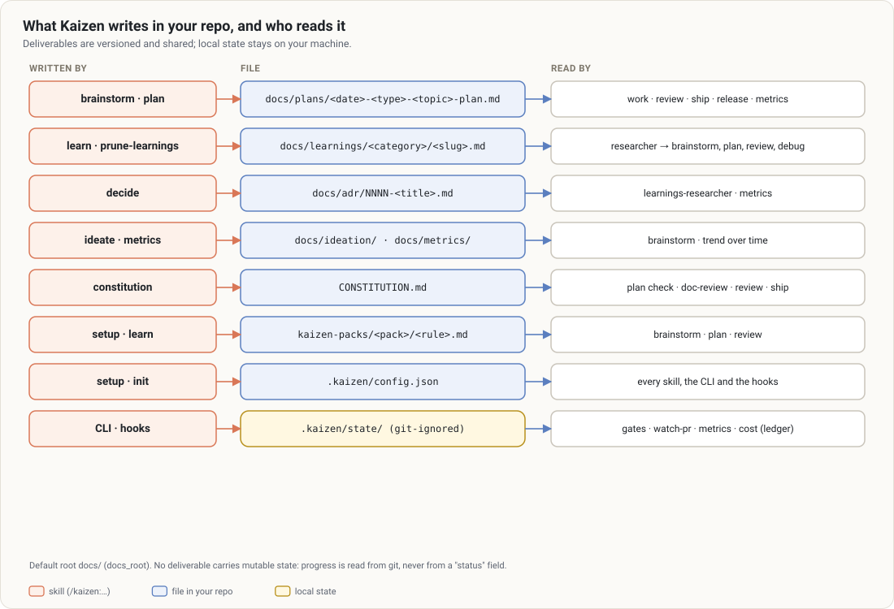

# Kaizen around agent-skills

> Each unit of work must make the next one easier.

## Who does what

AI coding agents take the shortest path to "done" and skip the invisible senior-engineer work: the
spec, the tests, the review, the scope. Two complementary answers:

| | agent-skills (Addy Osmani) | Kaizen |
|---|---|---|
| How | **written discipline**: each skill is a process with exit criteria, a table of excuses and their rebuttals, red flags, evidence to show | **enforced discipline**: hooks that block, whatever the agent intends |
| Covers | spec, plan, build, test, review, ship, constraints, simplification, performance, and a skill per concern (security, API design, observability…) | the gates around that work, the memory between cycles, the PR until it is ready, the measure |
| Lives in | `plugins/kaizen/agent-skills/` (embedded: a copy, synced from upstream by pull request, never edited) | `plugins/kaizen/` |

Kaizen never redoes what agent-skills does. It embeds it — one plugin to install — has four skills of
its own, and runs agent-skills' commands, skills and personas under its prefix.

## The commands

| Step | Command | Done by | Output |
|---|---|---|---|
| Set up (once) | `/kaizen:setup` | Kaizen | `.kaizen/config.json`, Kaizen declared for every clone, guard rails checked |
| Quality bar (optional, once) | `/kaizen:constraints` | agent-skills | `CONSTRAINTS.md`, its floor guard installed |
| Idea (optional) | `/kaizen:ideate` | agent-skills' `interview-me` and `idea-refine` | one refined concept, the `/kaizen:spec` to run |
| What | `/kaizen:spec` | agent-skills | `SPEC.md` |
| How | `/kaizen:plan` | agent-skills | `tasks/plan.md`, `tasks/todo.md` |
| Build | `/kaizen:build` (`auto`) | agent-skills | one commit per task, tests first |
| Prove | `/kaizen:test` | agent-skills | a failing test first; Prove-It for a bug |
| Something broke | `/kaizen:debug` | agent-skills' `debugging-and-error-recovery` | root cause fixed, with its test |
| Check | `/kaizen:review` | agent-skills, recorded by Kaizen | five-axis review, the push allowed |
| Launch | `/kaizen:ship` | agent-skills | go/no-go checklist |
| Follow | `/kaizen:watch` | Kaizen | the PR driven to "looks ready" |
| **You merge** | — | you | Kaizen never merges |
| Learn | `/kaizen:learn` | Kaizen | one durable lesson in `docs/learnings/` |
| Measure | `/kaizen:metrics` | Kaizen | DORA approximated, learnings reuse, friction, cost |

At any point, when the work calls for it (agent-skills' skills, through Kaizen's entry points):

| When | Command | Output |
|---|---|---|
| A decision worth keeping | `/kaizen:adr` | an Architecture Decision Record |
| Untrusted input, auth, secrets, data | `/kaizen:security` | findings by severity, each with its fix |
| A plan or a claim that must hold | `/kaizen:doubt` | an adversarial review and a verdict |
| Something to remove or replace | `/kaizen:migrate` | a deprecation or migration plan with rollback |

Around them: `/kaizen:code-simplify` and `/kaizen:webperf` (agent-skills). The `/kaizen:` commands of
agent-skills are generated from its own (`commands/`, by `scripts/aliases.mjs`, refreshed with each
agent-skills update), as are its personas (`agents/`: `kaizen:code-reviewer`…); its skills load as
`kaizen:<skill>`.

## What runs without being asked

Eight hook registrations ([Gates and hooks](gates.md)):

- editing a code file turns the **quality gate** on: no end of turn on red checks;
- agent-skills' **review records itself**, and an unreviewed branch is not pushed without your say;
- a **commit carrying a secret** is refused;
- writing `SPEC.md` or `tasks/`, or editing a file a learning is about, **brings the learnings back**;
- each turn's tokens are **charged to the work item** (`kaizen cost`).

## Who decides what

| Decision | Who |
|---|---|
| What to build, the scope, the trade-offs | **you**, through agent-skills' interview and spec |
| How to build it, within the plan | Claude, following agent-skills' process |
| Whether checks pass, whether a review happened, whether a push may go | **deterministic gates** (Kaizen's hooks), not Claude's word |
| Skipping the review | **only you**: Claude asks (the review first), you confirm in Claude Code's prompt |
| Merging, deploying | **only you**, with your own tools |

## Knowing where you are

`/kaizen:setup` (backed by `node $K status`) reads the repository and names the next command, first
match wins:

1. Kaizen not initialized → `/kaizen:setup`.
2. The quality gate stopped the last turn → make the checks green.
3. Tasks left in `tasks/todo.md` → `/kaizen:build`; a spec without tasks → `/kaizen:plan`.
4. Code changed on a branch (the spec and `tasks/` do not count): not reviewed → `/kaizen:review`;
   reviewed and committed → `/kaizen:ship`; reviewed and pushed → `/kaizen:watch`.
5. Otherwise → `/kaizen:spec <what to build>`.

## Models per phase

Kaizen sets no model on the commands: without a choice, everything — subagents included — runs on the
session's model. Not every phase needs the same one. Deciding (spec, plan, debug) and controlling
(review, security) are where a weaker answer costs the most; executing a detailed plan (build, test,
PR follow-up) is most of the tokens and needs less. The split Kaizen recommends:

| Phase | Commands | Model | Effort | How |
|---|---|---|---|---|
| Design | `/kaizen:ideate`, `spec`, `plan`, `adr`, `doubt`, `migrate`, `debug` | Opus | `high` for `plan` and `debug` | a design session: `claude --model opus` |
| Build | `/kaizen:build`, `test`, `code-simplify`, `webperf`, `watch`, `learn`, `metrics` | Sonnet | `medium` | a **fresh** session: `claude --model sonnet --effort medium` |
| Review | `/kaizen:review`, `security`, `ship` | Opus | `high` | a review session: `claude --model opus --effort high` |
| Personas | `kaizen:code-reviewer`, `kaizen:security-auditor` | Opus | `high` | set in their definitions (`agents/`), always |
| Personas | `kaizen:test-engineer`, `kaizen:web-performance-auditor` | Sonnet | the session's | set in their definitions (`agents/`), always |

**One session per phase**, the files carrying the context: `SPEC.md` and `tasks/plan.md` written in the
design session are what the build session reads, the branch is what the review session reads. A fresh
session also rereads less context than a long one. Effort can change mid-session (`/effort high` before
`/kaizen:plan`) without losing the prompt cache; a model cannot.

**Why not `model:` in the commands.** Claude Code supports it, but a command's model only lasts for the
turn it was invoked in: the session model resumes with your next prompt — so the "approve" that starts
`/kaizen:build auto` would build on the session's model anyway. Each model has its own prompt cache:
switching for one command and back recomputes the whole context twice. And `opusplan` only routes plan
mode, which only `/kaizen:plan` enters: spec, review and security would run on Sonnet, the opposite of
the aim. So the commands stay as agent-skills writes them, and the choice is made where it holds — the
session — while the personas, which start a context of their own anyway, carry theirs.

**Guard rails for a Sonnet build:**

- a plan Sonnet can execute: per task, the acceptance criteria, the files to touch, the command that
  verifies it (`/kaizen:doubt` on the plan for risky features);
- the quality gate escalates: from block `models.escalate_after` (2) on, it asks for an Opus subagent to
  find the root cause ([The quality gate](gates.md#the-quality-gate));
- the review before push stays on Opus — the review session, or the `code-reviewer` persona.

**Turn it on with `models.enabled`** ([Configuration](../reference/configuration.md#models)): `node $K
status` and `/kaizen:setup` then name, with the next command, the session to open for it, and the
quality gate escalates. It is advice: Kaizen never changes your model. Off by default, until measured on
your own features: the same feature built twice from the same spec and plan, once on Opus, once on
Sonnet with an Opus review, compared with `/usage`, `node $K cost <item>`
([Cost](metrics.md#cost-work_items-kaizen-cost)), the quality gate's blocks and the review's findings.

## Where everything lives

No file carries a mutable "status": progress is read from git and from agent-skills' task checkboxes.
Every file: [State and files](../reference/state-and-files.md).
