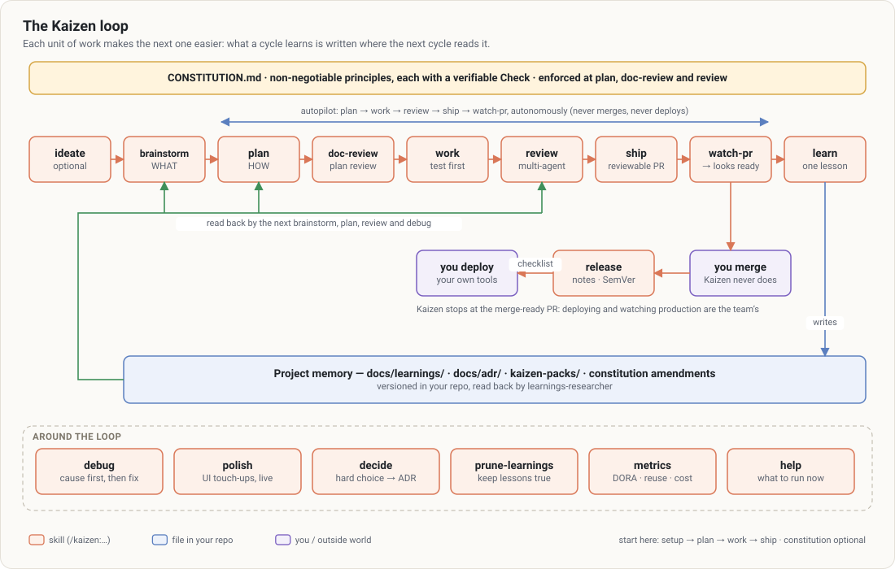

# Getting started

From nothing to a first merged feature: install, set up, then one cycle — spec, plan, build, review,
ship, watch, learn. About 30 minutes on a small feature.

For an overview first: [the presentation video](../../../media/kaizen/kaizen-presentation.mp4) (80 seconds,
voice-over and [subtitles](../../../media/kaizen/kaizen-presentation.srt)).



## 1. Install

In Claude Code, add the marketplace and enable both plugins:

```
/plugin marketplace add Lingelo/dojo
/plugin install agent-skills@dojo
/plugin install kaizen@dojo
```

`agent-skills` does the work (spec, plan, build, test, review, ship); `kaizen` guards it, keeps the
learnings, follows the PR and measures. Kaizen needs Node ≥ 18 and git; `gh` (authenticated) for pull
requests.

## 2. Set up the repository

```
/kaizen:setup
```

Claude:
- creates `.kaizen/config.json` and `docs/learnings/`;
- shows the `test`, `lint` and `typecheck` commands it found and asks you to confirm them — **these are
  what the quality gate runs** after any turn that edits code;
- offers to declare both plugins in the versioned `.claude/settings.json`, so every clone and cloud
  session gets them;
- offers the git hooks (no unreviewed push, no secret committed, even outside Claude Code);
- runs `kaizen doctor` and says what to run next.

Every ⚠ of the doctor is a guard rail that is off: [Gates and hooks](concepts/gates.md#doctor).

## 3. Spec

```
/kaizen:spec Export the orders list as a CSV that opens in Excel
```

agent-skills' spec-driven workflow: it lists its assumptions, asks what is unclear, and writes
`SPEC.md` (objective, commands, structure, style, tests, boundaries, success criteria). When `SPEC.md`
is written, **Kaizen adds the learnings of this repository that match it** to Claude's context — a
past trap with CSV exports comes back by itself.

Optional, once per project: `/kaizen:constraints` writes the quality bar (`CONSTRAINTS.md`) and installs
its floor guard against skipped tests and silenced checks.

## 4. Plan

```
/kaizen:plan
```

`tasks/plan.md` (decisions, risks) and `tasks/todo.md`: small tasks, each with acceptance criteria,
verification, dependencies and the files it will touch. Approve it before building.

## 5. Build

```
/kaizen:build          # the next task
/kaizen:build auto     # every task, after one approval
```

One task at a time: a failing test, the code, the full suite, a commit. **The quality gate is on as soon
as a code file is edited**: Claude cannot end the turn while the checks are red (three attempts, then it
must tell you what is still red). Nothing to turn on, nothing to turn off.

For a bug: `/kaizen:test` with the symptom — a reproduction that fails first, then the fix.

## 6. Review

```
/kaizen:review
```

The five-axis review (correctness, readability, architecture, security, performance). **Kaizen records
it by itself**: the reviewed tree and the verdict the review wrote. A Critical finding blocks the push of
that same tree; fix it and review again.

## 7. Ship and watch

```
/kaizen:ship
/kaizen:watch
```

`/kaizen:ship` runs the pre-launch checklist with specialist personas and gives a go/no-go. On "go",
ask Claude to push and open the PR (`gh pr create`): the push gate lets it through, the branch was
reviewed. `/kaizen:watch` then follows the PR: review comments handled first (a fix pushed
before each reply), red CI repaired, branch updated only when GitHub says it is behind. It ends on
"looks ready to merge" — **merging stays yours**.

## 8. Learn

```
/kaizen:learn
```

If something was not obvious — a surprising cause, a dead end — Claude writes one learning in
`docs/learnings/`. If not, it says so and writes nothing. Next time a spec, a plan or an edit touches the
same area, it comes back.

## What next

- Where am I? `/kaizen:setup` (or `node $K status`) names the next command.
- Are we improving? `/kaizen:metrics` after a few weeks, `kaizen cost <item>` for one feature.
- Many learnings, some stale? `/kaizen:learn prune`.
- Something blocks? [Troubleshooting](troubleshooting.md).
