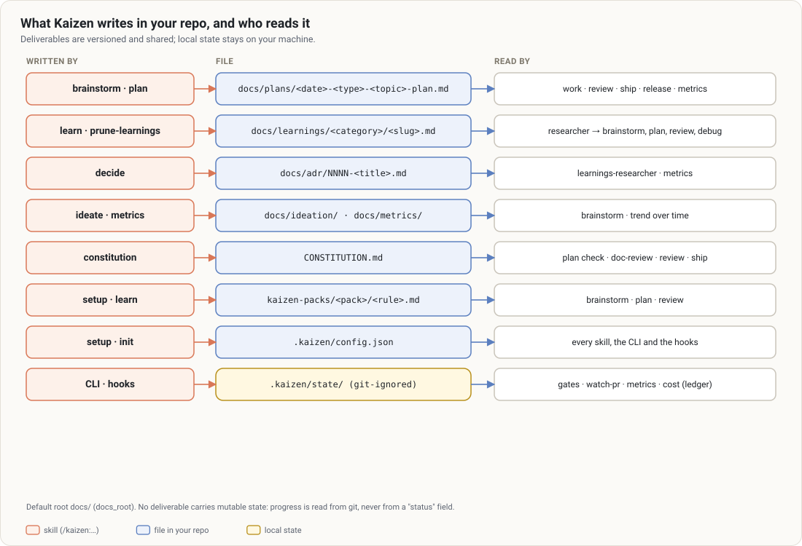

# State and files

Everything Kaizen reads and writes, where it lives, who writes it, and whether it is shared.

## Versioned (shared with the team)

| Path | Written by | Notes |
|---|---|---|
| `<docs>/learnings/<folder>/<slug>.md` | `/kaizen:learn` | one lesson per file, [format](../concepts/learnings.md#the-format); `docs_root` is `docs/` by default |
| `<docs>/metrics/YYYY-MM-DD.md` | `/kaizen:metrics`, on request | trend reports |
| `.kaizen/config.json` | `/kaizen:setup`, `init`, you | [configuration](configuration.md) |
| `.claude/settings.json` (three keys) | `install settings`, with approval | the dojo marketplace, `kaizen@dojo`, `agent-skills@dojo` |
| `.githooks/pre-push`, `.githooks/pre-commit` | `install git-hooks`, with approval | [git hooks](../concepts/gates.md#without-the-plugin-git-hooks); each clone runs `git config core.hooksPath .githooks` |
| one line in `CLAUDE.md` or `AGENTS.md` | `/kaizen:setup`, with approval | makes the learnings findable by any agent |

**Read, never written, by Kaizen** — agent-skills' files: `SPEC.md` (or `docs/SPEC.md`), `tasks/plan.md`,
`tasks/todo.md`, `CONSTRAINTS.md` (`scripts/agentskills.mjs`, tolerant of any shape). `status` reads the
tasks left, `post-edit.mjs` brings learnings back when they are written, `metrics` counts the learnings
they cite, `doctor` checks `CONSTRAINTS.md`'s floor guard. Plans of Kaizen 5.x in `<docs>/plans/` are
still read by `metrics` and `cost`.

No file carries a mutable "status": progress is read from git and from the task checkboxes.

## Personal

| Path | Notes |
|---|---|
| `.kaizen/config.local.json` | your overrides, git-ignored by `init` (`docs_root` is not read from it) |

## Local state (`.kaizen/state/`, git-ignored)

The folder carries its own `.gitignore` (`*`). Deleting it is harmless: Kaizen forgets the work in
progress, the reviews recorded (the next push asks for one) and the cost history.

| File | Written by | Content | Lifetime |
|---|---|---|---|
| `gate.json` | `post-edit.mjs`, Stop hook | active, session, since, blocks, files edited, last failure | until green, `gate off`, `max_blocks` or `gate.max_age_hours` |
| `reviews.json` | review hooks, waiver confirmation | per branch: head, tree, verdict, source, depth, session, at (waiver: reason, confirmed_by) | replaced per branch |
| `review-pending.json` | PostToolUse on Skill | agent-skills' review skill was loaded this turn: read by the Stop hook | until that Stop |
| `waivers.json` | `review waive` | code, reason, branch, head, tree, at | 30 min |
| `push-offers.json` | review hook (`require_before_push: "ask"`) | per branch: the commit you were asked about | 30 min, used by the next push of that commit |
| `confirm-asks.json` | review hook, before `confirm <code>` | Claude Code's prompt was shown for that code | 10 min, single use |
| `hooks-seen.json` | SessionStart hook | the last time Kaizen's hooks fired here (`doctor`) | replaced |
| `learnings-seen.json` | `post-edit.mjs` | learnings already brought back: per planning file content, per session | kept |
| `friction.jsonl` | every gate that stops the work, and what lifts it | at, gate, kind (`refused`, `asked`, `skip_confirm`, `blocked`, `released`, `no_verify`, `review_recorded`, `waiver_requested`, `waiver_confirmed`), reason, branch, checks, source | kept |
| `ledger.jsonl` | Stop hook `ledger-hook.mjs` | at, session, item, kind, title, branch, source, usage per model, subagents | kept |
| `ledger-cursor.json` | Stop hook `ledger-hook.mjs` | byte offset and last message ids per transcript already charged | kept |
| `cost-dashboard.html` | `metrics dashboard` | the HTML dashboard | replaced |
| `pr/<owner>-<repo>-<n>.json` | `pr snapshot`, `pr mark` | threads, comments, checks handled, started_at, budget, last head | delete to start over |

Writes to `reviews.json`, `review-pending.json`, `waivers.json`, `push-offers.json`, `confirm-asks.json`
and `hooks-seen.json`, and direct calls of `review-hooks.mjs`, are refused by the PreToolUse hook: only
the hooks write them.

## Outside the repository

| Path | Content |
|---|---|
| Claude Code transcripts (`~/.claude/projects/…`) | read by the Stop hooks: the review agent-skills' skill wrote, and the tokens of each turn (main session and `subagents/agent-*.jsonl`) |

## Environment variables

| Variable | Read by | Role |
|---|---|---|
| `CLAUDE_PLUGIN_ROOT` | skills, hooks | the plugin's folder (set by Claude Code) |
| `KAIZEN_CLI` | git hooks | path of the Kaizen CLI to run (else `git config kaizen.cli`, else the dojo plugin cache) |
| `KAIZEN_GH` | `pr`, `metrics` | replacement for `gh` (tests) |
