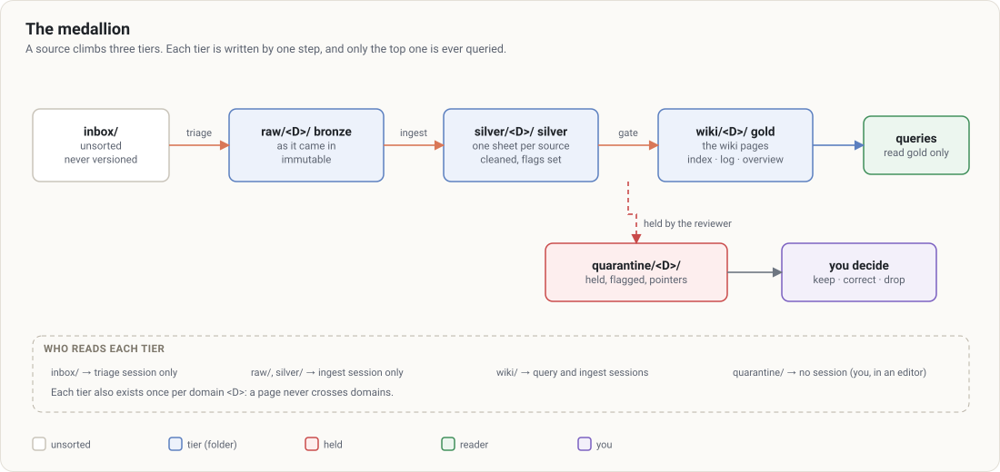

# Kioku

Un coffre de connaissance pour [Claude Code](https://docs.claude.com/en/docs/claude-code), sur le modèle *LLM Wiki* : vous déposez des sources brutes, Claude maintient un wiki structuré, et un schéma fixe les règles. Kioku ajoute trois garanties tenues par du code, pas par une consigne :

- **Médaillon** : bronze (`raw/`, la source telle qu'elle est entrée, immuable) → argent (`silver/`, une fiche nettoyée par source) → or (`wiki/`, les pages). On ne requête que l'or.
- **Silos** : un coffre a plusieurs domaines (par exemple `travail` et `perso`). Une session est ouverte sur un seul domaine ; un hook `PreToolUse` refuse toute lecture ou écriture dans un autre. Hors d'un coffre (ni `kioku.config.json`, ni `wiki/`, `raw/`, `silver/`, `domains/`, `.kioku/`), le hook ne s'applique pas : le plugin installé au niveau utilisateur ne gêne pas vos autres projets. Un dossier de coffre sans configuration lisible est traité comme abîmé : tout y est refusé (`kioku doctor` le signale).
- **Gate** : aucune page n'entre dans l'or sans un contrôle déterministe (format, provenance, secrets) puis un verdict d'un relecteur distinct du rédacteur, lié à l'empreinte exacte de la page.

Le core (ce dépôt) ne contient aucune donnée. Votre coffre est un dossier à part, dans votre propre dépôt privé.

## Prérequis

- Node.js 20 ou plus, git
- Claude Code installé et authentifié

## Installation

Le plugin porte tout : la garde et la gate, les skills (création du coffre, ingestion, requête, tri, relecture), le relecteur, le lanceur de sessions, le dashboard et le circuit Plaud. Il est distribué par la marketplace [dojo](https://github.com/<owner>/dojo) et s'installe une fois par machine, au niveau utilisateur. Claude Code le met à jour depuis la marketplace si son auto-update est activé (`/plugin` > Marketplaces > dojo > Enable auto-update ; désactivé par défaut pour une marketplace tierce).

```
/plugin marketplace add <owner>/dojo
/plugin install kioku@dojo --scope user
```

Pour lancer les sessions depuis un terminal (`npm run <silo>`), le relais `kioku` dans le PATH : `sh ~/.claude/plugins/cache/dojo/kioku/<version>/scripts/install.sh <owner>/dojo` (le dossier `<version>` est le SHA du plugin installé ; le script fait aussi les deux commandes ci-dessus si besoin). Le relais ne vise aucune version : il lance le plugin installé, ou refuse.

**Développement sur un clone** : `KIOKU_HOME=~/kioku` posé, le relais utilise ce core-là, avant le plugin, et le dit sur stderr. Sans `KIOKU_HOME` ni plugin installé, le relais refuse : il ne se rabat jamais sur un clone. Pour essayer sans rien installer : `claude --plugin-dir ~/kioku`.

## Créer un coffre

Dans un dossier vide (ou un dépôt git vide) :

```bash
mkdir mon-coffre && cd mon-coffre && claude
/kioku:setup                                         # questions : silos, registre, Plaud ; puis kioku init
/exit
npm run travail                                      # première session, sous la garde
```

Ou depuis un terminal : `kioku init ~/mon-coffre --domains travail,perso [--org travail] [--plaud]`, puis `kioku doctor --live`.

`init` crée la configuration (`kioku.config.json` : silos, numéro de format, session par défaut sur le premier silo), le squelette de chaque silo (`index.md`, `log.md`, `overview.md`), ses règles (`domains/<D>/rules.md`, à partir d'un preset), le schéma commun (`.kioku/schema.md`) et un `CLAUDE.md` qui l'importe, un `package.json` aux commandes par silo, `.gitignore`, `.gitattributes`, et l'activation du plugin dans `.claude/settings.json` (sans version). `--guard-hook` remplace le plugin par un hook vers la garde du clone (développement, non portable).

Le coffre est votre dépôt : poussez-le où vous voulez, **à condition qu'il soit privé** (il contient vos silos en clair). `doctor` prouve le cloisonnement : il sonde la garde pour chaque paire de silos, et `--live` ouvre une vraie session qui doit être refusée en lisant un autre silo.

Ajouter un silo plus tard : `kioku add-domain <nom> [--preset minimal|pro|perso]`, ou `/kioku:add-domain` dans une session `setup`.

**Versions** : le coffre ne porte pas de version du plugin, seulement un numéro de format (`format` dans `kioku.config.json`). Un plugin trop ancien pour ce format refuse de démarrer et donne la commande de mise à jour (`claude plugin update kioku@dojo`) ; un plugin plus récent lit les coffres plus anciens, et `kioku upgrade` les amène à la forme courante.

### Parties gérées et `kioku upgrade`

Un coffre en service doit rester ce qu'`init` produit, plus vos données et vos personnalisations. `kioku upgrade` l'y ramène après une montée de version : sans `--write`, il montre le diff ; avec, il l'applique (idempotent). Il ne réécrit que les parties gérées :

| Fichier | Partie gérée |
|---|---|
| `package.json` | les scripts dont la valeur commence par `kioku ` ; vos autres scripts restent intacts |
| `.gitignore` | le bloc `# >>> kioku` … `# <<< kioku` |
| `.claude/settings.json` | `enabledPlugins["kioku@dojo"]` ; retire les anciens identifiants Kioku (`kioku-pin`, `kioku@kioku`) |
| `kioku.config.json` | ajout seul (`format`, `default_session`, `modules`), jamais une valeur posée |
| `.kioku/schema.md` | entier |

Jamais touchés : les données (`wiki/`, `raw/`, `silver/`), `CLAUDE.md`, `domains/*/rules.md`, `orgs.json`. Un script géré que la version courante ne produit plus est signalé, pas supprimé.

## Au quotidien

Le [guide d'utilisation](docs/guide/README.md) (en anglais, illustré de schémas) détaille chaque étape : sessions, ingestion, gate, requêtes, lint et quarantaine, dashboard, Plaud, mises à jour, dépannage ; un [cheat sheet](docs/guide/cheat-sheet.md) tient sur une page.



| Besoin | Commande |
|---|---|
| Poser une question au wiki | session `query` sur le domaine, puis `/kioku:query …` ou une question libre |
| Faire entrer une source | la déposer dans `raw/<D>/…`, session `ingest`, `/kioku:ingest <fichier>` |
| Ranger l'entrant | session `triage`, `/kioku:triage` |
| Relire le wiki | `/kioku:lint <D>` en session `query` |
| Filer une analyse durable | `/kioku:save` |

Les scripts npm du coffre (générés par `init`) ouvrent les sessions et les outils :

| Script | Effet |
|---|---|
| `npm run <D>` · `ingest:<D>` · `lint:<D>` | session `query`, `ingest`, ou `query` démarrée sur `/kioku:lint <D>` |
| `npm run triage` · `setup` | session de tri de l'entrant, ou d'installation |
| `npm run dashboard:<D>` · `dashboard:serve:<D>` · `dashboard:all` | HTML statique, serveur local au premier plan (Ctrl-C), tous les domaines (hors session) |
| `npm run audit:<D>` · `undecided` · `doctor` | état de l'or, sources à trancher, preuve du cloisonnement |
| `npm run plaud:sync` · `plaud:dry-run` · `plaud:pending` · `plaud:drop` | circuit Plaud, si le module est déclaré |

Chacun appelle `kioku session|dashboard|plaud|…` ; la session porte `VAULT_MODE` (`query`, `ingest`, `triage`, `setup`) et `VAULT_DOMAIN`, que la garde lit. Attention : un `VAULT_MODE` ou un `VAULT_DOMAIN` **exporté dans votre shell** remet la garde en marche hors coffre (elle refuse tout dans un projet ordinaire) : ne les exportez pas, laissez le lanceur les poser.

## Modules optionnels

- **Dashboard** (`tools/dashboard/`) : état du médaillon, graphe 3D de l'or, et questions au wiki depuis un navigateur local. La vidéo de présentation de l'onglet Mode d'emploi n'est pas versionnée (trop lourde) : sa source est `tools/dashboard/video/` ; déposez le rendu dans `tools/dashboard/vendor/media/kioku-explainer.mp4`.
- **Plaud** (`tools/plaud-sync/`) : dépose les notes d'un enregistreur Plaud dans l'entrant, les trie par domaine, demande confirmation, puis les ingère.

## Ce que la garde ne fait pas

- Elle filtre les outils de Claude Code, pas vos propres commandes dans un terminal.
- Elle juge le texte des commandes shell, pas leurs effets : elle bloque des formes connues, elle ne sandboxe pas.
- La gate vérifie la provenance, pas la vérité ; le relecteur est un autre appel de modèle dans la même session.

## Contribuer

`npm install` branche un hook `pre-push` qui refuse tout push portant un terme d'une liste privée (`KIOKU_DENYLIST`, un fichier hors du dépôt). Les tests : `npm test`.

## Licence

MIT
