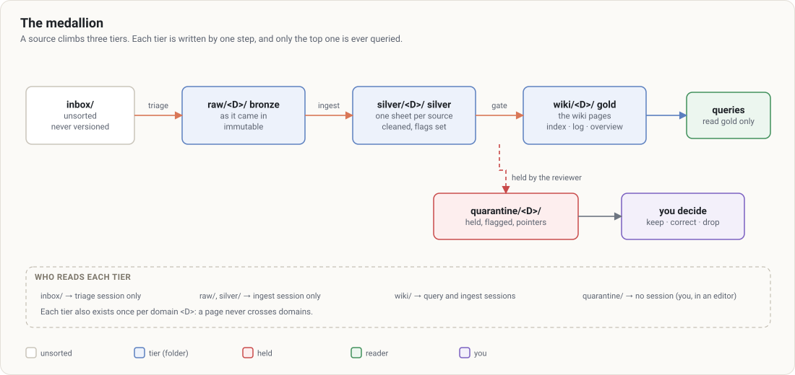

# 1. Concepts

[← Contents](README.md)

## The medallion: three tiers



| Tier | Folder | Role |
|---|---|---|
| Inbox | `inbox/` | what hasn't been sorted yet. **Never versioned** (`.gitignore`): triage it before changing machines. |
| Bronze | `raw/<D>/{meetings,articles,pdfs,transcripts,assets}/` | the source as it came in. Nobody rewrites it. |
| Silver | `silver/<D>/<slug>.md` | one sheet per source: summarised, speakers resolved (as a stated hypothesis), sensitive passages removed. |
| Gold | `wiki/<D>/{sources,meetings,people,organizations,projects,concepts,decisions,syntheses}/` | the wiki pages, with `index.md`, `log.md`, `overview.md`. |
| Quarantine | `quarantine/<D>/` | what the gate held, what the lint flagged, passages set aside at ingest. |

## Domains (silos)

A vault has one or more domains, declared in `kioku.config.json`. Each has its own four tiers, its rules (`domains/<D>/rules.md`) and its wiki. **A page never changes domain**, and no link crosses two domains.

The domain is decided **once**, at triage. In the slightest doubt, triage abstains and asks.

## The guard

A `PreToolUse` hook shipped by the plugin. On every Claude Code tool call (read, write, shell command), it compares the target with the session's **mode** and **domain** (`VAULT_MODE`, `VAULT_DOMAIN`, set by the launcher) and refuses what lies outside.

- Outside a vault it does not apply: the plugin doesn't get in the way of your other projects.
- It filters Claude's tools, **not your own commands** in a terminal.
- It judges the text of shell commands, not their effects: it blocks known forms, it is not a sandbox.
- No session can modify it.

## The gate

The only way into gold. The writer never judges its own page: a **distinct reviewer** gives a verdict bound to the page's exact sha256. Change a comma, and the verdict no longer holds. Details: [4. The gate](04-gate.md).

## Legacy gold

Pages under `wiki/<D>/` **without a `gate:` line** are legacy gold (a wiki that existed before Kioku). They are read like the others; the lint samples them; a legacy page that gets modified goes through the gate again.

## The vault's files

```
<vault>/
├── CLAUDE.md                 the vault's identity and decisions; imports .kioku/schema.md
├── kioku.config.json         domains, extensions, modules, format (managed: don't edit it in a session)
├── .kioku/schema.md          the common schema, rewritten on every upgrade
├── domains/<D>/rules.md      domain rules: Périmètre, Ingestion, Requête, Lint, Relecture
├── package.json              npm scripts (those starting with "kioku" are managed)
├── raw/<D>/ silver/<D>/ wiki/<D>/ quarantine/<D>/
├── .candidats/wiki/<D>/      pages waiting for the gate
├── .verdicts/                reviewer verdicts
└── inbox/                    inbox (never versioned)
```

The section names in `rules.md` and some folder names (`.candidats/`) are in French: they are read by the code, and kept as is.
