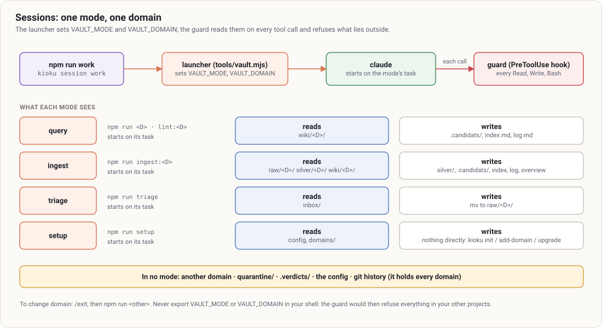

# 2. Sessions

[← Contents](README.md)

A session is a `claude` started in the vault with a **mode** and a **domain**. Never start it bare: the launcher sets the two variables the guard reads, then starts the session on its mode's task.



## Opening a session

| Command | Mode / domain | Starts on |
|---|---|---|
| `npm run work` | query / work | your question |
| `npm run ingest:work` | ingest / work | `/kioku:ingest` (lists what is left to ingest) |
| `npm run lint:work` | query / work | `/kioku:lint work` |
| `npm run triage` | triage (no domain) | `/kioku:triage` |
| `npm run setup` | setup (no domain) | `/kioku:setup` |
| `npm run vault` | query, domain asked | your question |

These scripts call `kioku session …`. Useful options, after `--`:

```bash
npm run work -- "what did we decide on the budget?"     # the question goes with the session
npm run ingest:work -- meetings/2026-03-12-review.md    # /kioku:ingest on that file
kioku session work -- --resume                          # resume a session (passed to claude)
```

## What each mode sees

| Mode | Reads | Writes |
|---|---|---|
| **query** | `wiki/<D>/` | `.candidats/wiki/<D>/`, `wiki/<D>/index.md` and `log.md` |
| **ingest** | `raw/<D>/`, `silver/<D>/`, `wiki/<D>/`, `.candidats/wiki/<D>/` | `silver/<D>/`, `.candidats/wiki/<D>/`, `wiki/<D>/{index,log,overview}.md` |
| **triage** | `inbox/` | `mv` to `raw/<D>/` |
| **setup** | configuration, `domains/` | nothing directly: `kioku init`, `kioku add-domain`, `kioku upgrade` |

In **no** mode: another domain, `quarantine/`, `.verdicts/`, the configuration, the git history (`git show`, `git log -p`, `git diff`…: it holds every domain).

## Changing domain

You don't change domain within a session. `/exit`, then `npm run home`. A question asked in the wrong domain gets a two-line answer: the domain it belongs to and the command to relaunch, with nothing of its content.

## Pitfalls

- **Never export `VAULT_MODE` or `VAULT_DOMAIN` in your shell.** The guard would switch on outside the vault and refuse everything in your other projects. Let the launcher set them.
- **Starting `claude` bare in the vault** opens the default session (`default_session` in the configuration, usually `query` on the first domain). Prefer the npm scripts, which say what they open.
- **A guard refusal is not a failure.** It is the rule applying. If it blocks wrongly, see [10. Troubleshooting](10-troubleshooting.md).
