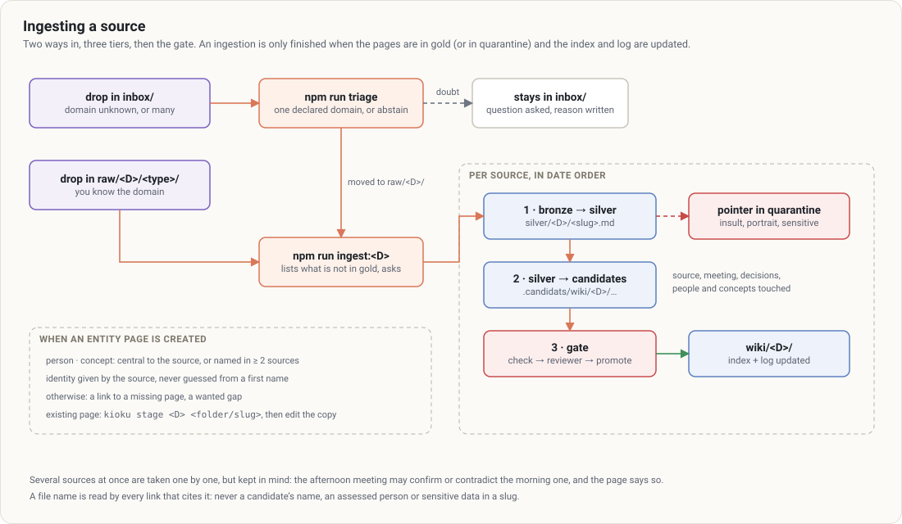

# 3. Bringing a source in

[← Contents](README.md)

## Two ways in

- **You know the domain**: drop the file in `raw/<D>/<type>/`, then `npm run ingest:<D>`.
- **You don't, or there are many**: drop them in `inbox/`, then `npm run triage`, then `npm run ingest:<D>`.

Folder types under `raw/<D>/`: `meetings`, `articles`, `pdfs`, `transcripts`, `assets`. File names in ASCII kebab-case, prefixed with the ISO date: `2026-03-12-budget-review.md`.

**A file name is read by every link that cites it**: never a candidate's name, an assessed person or sensitive data in a slug.

## Triage

`npm run triage` reads `inbox/`, then for each source picks **one declared domain** or **abstains**. It relies on each domain's `description` in `kioku.config.json`. A mixed source, one from an unknown organisation, or one mixing private life and work stays in the inbox with the reason: deciding wrongly pollutes a vault, not deciding costs a question.

## Ingestion

`npm run ingest:<D>` without an argument **starts nothing**: it lists the sources of `raw/<D>/` that aren't in gold yet and asks which to ingest. An ingestion run out of habit would write into gold.

For each source, three tiers, all the way:

1. **Bronze → silver.** The raw file is read, the sheet `silver/<D>/<slug>.md` is written. Speakers are resolved **as a stated hypothesis**. Insults, portraits, unattributed feedback and sensitive data are copied nowhere: a **pointer** goes to quarantine (`kioku quarantine`), and the sheet keeps the facts.
2. **Silver → gold.** From the silver sheet, never the raw file: candidates under `.candidats/wiki/<D>/`: the `sources/` page, the `meetings/` page for a meeting, decisions (ADRs), the entities touched.
3. **Gate.** `check` → reviewer → `promote`. See [4. The gate](04-gate.md).

Then the index and the log are updated, and a report lists: pages admitted, held, contradictions, gaps.

### Several sources at once

They are taken **one by one, in date order**, but the session keeps them in mind: the afternoon meeting may confirm or contradict the morning one, and the page says so. One index and log pass per day.

## When a page is created

| Page | Created when |
|---|---|
| `sources/`, `meetings/` | always, for the ingested source |
| `decisions/` | a decision is taken in the source |
| `people/` | the person is **central** to the source **or** named in **at least two sources**; identity given by the source, never guessed from a first name or a "Speaker 1" |
| `concepts/` | the notion is central **or** cited in at least two sources; no generic term, no duplicate |

Otherwise the link points to a missing page: a **wanted gap**, not an anomaly. Domain rules can restrict further.

## Changing a page already in gold

No rewriting by hand: `kioku stage <D> <folder/slug>` (ingest session of the domain) copies the page under `.candidats/`, without its `gate:` line. Edit it there, and it goes through the gate again.

## What is never done

- Filing a source in a domain "to go faster".
- Rewriting a raw file.
- Stopping after writing the candidates: an ingestion is only finished when the pages are in gold (or in quarantine) and the index and log are up to date.
