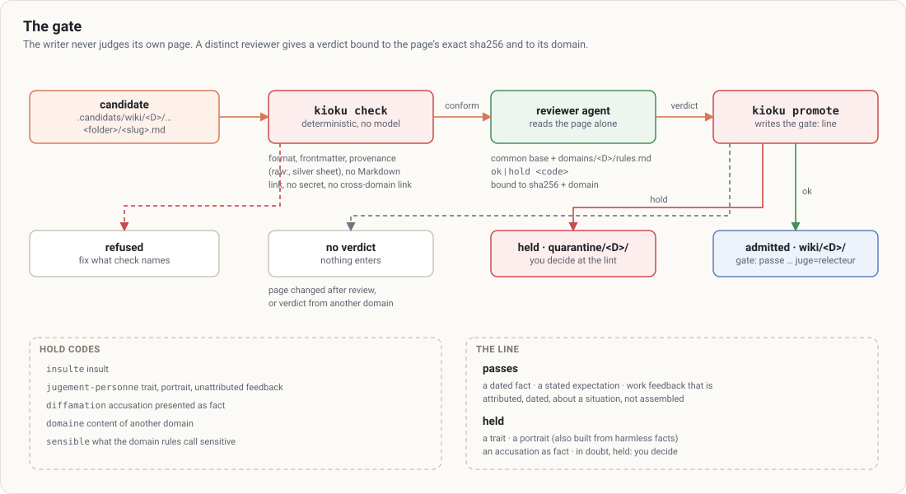

# 4. The gate

[← Contents](README.md)

Every page enters gold the same way, whether the session writes it during an ingestion, a synthesis or a correction.

## Outcomes

| Outcome | Why | What to do |
|---|---|---|
| **admitted** | `check` passes and the reviewer of the page's domain says `ok` for this exact version | nothing: the page is in `wiki/<D>/` with `gate: passe <date> juge=relecteur` |
| **refused** | format, frontmatter or provenance | fix what `check` names, run it again |
| **held** | verdict `hold <code>` | don't rewrite it; decide at the lint ([6](06-lint-quarantine.md)) |
| **no verdict** | the page changed after review, or the verdict was given for another domain | run the reviewer again on the current version, from a session of the page's domain |

## Hold codes

| Code | Meaning |
|---|---|
| `insulte` | insulting words |
| `jugement-personne` | a trait or portrait of a person, unattributed feedback presented as fact |
| `diffamation` | an accusation presented as fact |
| `domaine` | content of another domain |
| `sensible` | data the domain rules call sensitive |

## The line: work feedback versus portrait

**Passes**: a dated fact; a stated expectation; **attributed work feedback**, if it meets four conditions:

1. it is about professional conduct or results;
2. it is attributed and dated, with its source;
3. it is an observation about a situation, not a permanent trait;
4. it is not assembled into a portrait.

> "According to Alice, on 10/03, the module delivery slipped by a week for lack of acceptance testing." — passes.
> "Bob is slow." — held (trait).
> A list of harmless facts that, put end to end, draws a profile — held (portrait by assembly).

**In doubt, it is held**: you decide at the lint, and your decision can become a domain rule.

## Good to know

- **Any change voids the verdict.** It is bound to the exact content; a page changed after review must be reviewed again.
- **A verdict belongs to one domain.** A verdict given for `home` cannot promote a `work` page.
- **If the reviewer doesn't answer, nothing enters.** Say so, don't loop.
- **The `gate:` line is written by `promote`**, never by hand.
- `overview.md` is outside the gate (written in an ingest session) and reviewed at the lint.

## What the gate doesn't do

It checks **provenance**, not **truth**: a wrong source gives a wrong page, well sourced. The lint keeps that role (contradictions, stale claims). The reviewer is another model call in the same session: independence of context, not of process.
