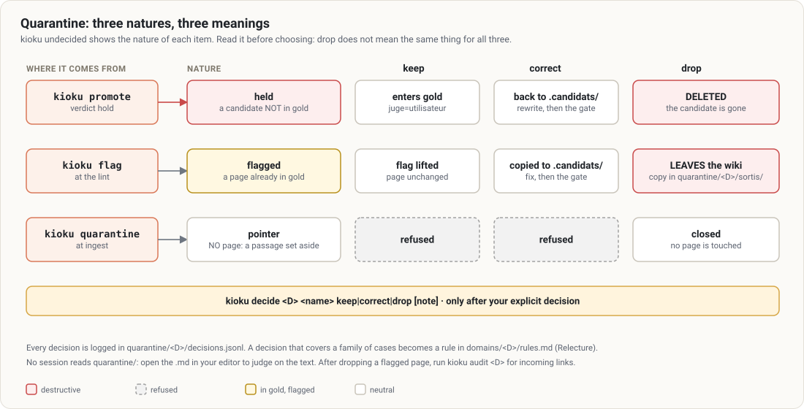

# 6. Reviewing and deciding

[← Contents](README.md)

## The lint

`npm run lint:<D>` opens a `query` session on `/kioku:lint <D>`. Nothing changes without your explicit agreement.

1. **Deterministic audit** (`kioku audit <D>`, free): pages without frontmatter, type ≠ folder, broken links, orphans, links to another domain, pages missing from the index, phantom index entries; `org-absent`, `org-union` for a domain with the `org` extension.
2. **Log**: if past months linger in `log.md`, the session **proposes** the rotation (`kioku rotate-log <D>`); you approve.
3. **Reading audit**: contradictions, stale claims, concepts without a page, gaps, next sources. **Legacy pages**: pages without `gate:` are sampled for insults, portraits, sensitive data; a case found is **flagged** (`kioku flag`), the page doesn't move.
4. **To decide**: the quarantine, one item at a time.
5. **Report** and log entry.

### Broken link or gap?

A link to a missing page, cited by **a single source** and **not central**, is a **wanted gap**. It becomes an anomaly when the target is cited by at least two sources, is central, or the link points to an existing page under another name.

## The quarantine

```bash
kioku undecided work      # or npm run undecided (every domain)
```

```
work/sources-2026-03-12-review   nature=retenue   code=sensible           date=…  wiki/work/sources/….md   [keep|correct|drop]
work/concepts-old-topic          nature=signalee  code=insulte            date=…  wiki/work/concepts/….md  [keep|correct|drop]
work/source-2026-03-14-workshop  nature=pointeur  code=jugement-personne  date=…  raw/work/…               [drop]
```



**Read the nature before choosing.** The three don't mean the same thing:

| Nature (`nature=`) | Comes from | What it is |
|---|---|---|
| **held** (`retenue`) | `promote`, verdict `hold` | a candidate page that is **not** in gold |
| **flagged** (`signalee`) | `kioku flag`, at the lint | a page **already** in gold, marked for decision; it stays in place |
| **pointer** (`pointeur`) | `kioku quarantine`, at ingest | a passage of a source **set aside** from the silver sheet; **no page**: the rest of the source is usually already in gold |

## Deciding

```bash
kioku decide <D> <name> keep|correct|drop [note]
```

- A `correct` page is rewritten in an ingest session of the domain, then `check` → reviewer → `promote`.
- Every decision is logged in `quarantine/<D>/decisions.jsonl`, with your note.
- A decision that covers a family of cases becomes a **rule**: section `Relecture` of `domains/<D>/rules.md`. You write it yourself, outside any session.
- After dropping a flagged page, run `kioku audit <D>`: incoming links need cleaning.

## The content of a quarantined page

No session reads `quarantine/` (guard). To judge on the text, open the `.md` file in your editor, outside Claude Code.
