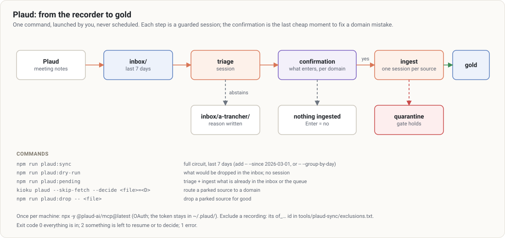

# 8. Capture modules

[← Contents](README.md)

Optional modules that bring outside sources into the vault in one command. Two exist: **[Plaud](#plaud)** (meeting notes from a recorder) and **[Mail](#mail)** (Gmail threads under a label you choose). Both run the **same circuit**; only the first step differs.

## The common circuit



1. **Drop**: the module puts new sources in `inbox/` (already seen or excluded ones are skipped). No domain yet.
2. **Triage**: a triage session files them in `raw/<D>/`, or parks them in `inbox/a-trancher/` with a written reason.
3. **Confirmation**: the list of what is about to enter gold, **per domain**, waits for a "yes" (Enter = no).
4. **Ingestion**: one ingest session per source (or per day with `--group-by-day`), gate included.
5. **Report**: ingested / not in (to resume) / to route / to decide (quarantine).

**The confirmation at step 3 is the last moment** a domain mistake is cheap to fix: after it, the source is in the wrong domain's wiki.

Launched **by you, never scheduled**, from the vault's main checkout (`inbox/` is not versioned; refused in a worktree unless `--allow-worktree`). **One circuit at a time per vault**, Plaud and Mail included: they share one lock (`tools/connectors/.lock.json`), also taken by `kioku rotate-log`, `tag-org`, `upgrade --write` and `add-domain`.

Options common to both modules: `--since <date>`, `--dry-run`, `--skip-fetch`, `--decide <file>=<D>`, `--yes`, `--group-by-day`, `--retries <n>`, `--retry-delay <s>`.

### Parked sources (`inbox/a-trancher/`)

Triage abstains in the slightest doubt. Read `inbox/a-trancher/_raisons.md` and the files **in your editor**, outside any session (no `query` session reads the inbox). Then:

| Outcome | Plaud | Mail |
|---|---|---|
| route to a domain | `kioku plaud --skip-fetch --decide <file>=<D>` | `kioku mail --skip-fetch --decide <file>=<D>` |
| drop for good | `npm run plaud:drop -- <file>` | `npm run mail:drop -- <file>` |
| leave for later | nothing | nothing |

### Exit codes

`0` everything is filed and ingested; `2` sources are left to resume or to route; `1` error.

## Plaud

`modules.plaud` in `kioku.config.json`, set by `kioku init --plaud`.

### Once per machine

```bash
npx -y @plaud-ai/mcp@latest      # OAuth in the browser; the token stays in ~/.plaud/
```

The circuit never reads a token itself: authentication is delegated to the official MCP.

### Commands

| Command | Effect |
|---|---|
| `npm run plaud:sync` | full circuit, last 7 days |
| `npm run plaud:sync -- --since 2026-03-01` | since a date |
| `npm run plaud:dry-run` | shows what would be dropped; no session |
| `npm run plaud:pending` | triage + ingest what is already in the inbox or the queue (`--skip-fetch`) |
| `npm run plaud:sync -- --group-by-day` | one session per day and per domain: meetings of the same day cross-check |
| `npm run plaud:sync -- --skip <id>` | drop a recording for good |
| `npm run plaud:sync -- --yes` | ingest without asking (required without a terminal) |

### Excluding a recording at the source

Add its `of_…` id to `tools/plaud-sync/exclusions.txt`, with a comment: it will never be dropped.

## Mail

`modules.mail` in `kioku.config.json`, set by `kioku init --mail` (or `kioku upgrade --write` once you declare it). Gmail only for now.

- **Opt-in by label.** Only threads carrying the label you configure (`kb` by default) are read. Put the label on a thread in Gmail to capture it. System labels (`INBOX`, `SENT`…) are refused: they would capture the whole mailbox. The label selects the **thread**: every message of a labelled thread is captured, including a reply that does not carry the label itself. Drafts, messages in the trash and spam are never captured.
- **One thread = one source.** Each **PDF attachment** becomes a separate source, linked to its thread. Other attachments are ignored and listed in the report.
- **Read-only.** Scope `gmail.readonly`: Kioku never writes to your mailbox (the label stays). What was already captured is tracked in the vault (`tools/mail-sync/seen.json`).
- **A late reply** to a captured thread becomes a new source, a **follow-up** holding only the new messages. Bronze is never rewritten.

### Adoption cost: read this first

There is no shared Kioku app. **Each user creates their own OAuth client** in their Google Cloud console. It takes about ten minutes, once. On a **Google Workspace** account, an administrator may block unverified apps: then the login fails and there is nothing to work around on your side. Wait for an IMAP provider (planned, not available yet), or ask your administrator.

### Once per user

1. In the [Google Cloud console](https://console.cloud.google.com/): create a project, enable the **Gmail API**, configure the consent screen (type *External*, your address as test user; scope `.../auth/gmail.readonly`), then create an **OAuth client ID** of type **Desktop app**.
2. Download its JSON and save it as `~/.config/kioku/mail/client.json` (`$XDG_CONFIG_HOME/kioku/mail/` if set; `%APPDATA%\kioku\mail\` on Windows). Never inside the vault. This file is only read once: `mail:login` imports it into your system keychain and offers to delete it (it never deletes it without your yes).

In *Testing* mode, Google expires the refresh token after 7 days: you will need to log in again. Publishing the consent screen (still unverified, for your own use) avoids that.

### Once per account

Declare the account in `kioku.config.json` (by hand, outside a session):

```json
"modules": {
  "mail": {
    "state": "tools/mail-sync",
    "accounts": [
      { "id": "work", "provider": "gmail", "label": "kb", "hint": { "domain": "work", "org": "acme" } }
    ]
  }
}
```

`hint` is optional. It is **a hint for triage, never a decision**: triage still reads the content and may file elsewhere or abstain. `hint.domain` must be a declared domain, `hint.org` an id of that domain's organization registry; otherwise the whole configuration is refused (the guard too refuses everything until it is fixed), and `kioku doctor` says why.

Then, **from a terminal** (not in a Claude session):

```bash
npm run mail:login -- work      # opens the browser; the token goes to your system keychain
```

The token is refreshed automatically. If Google refuses the refresh (revoked, password changed, 7-day test expiry), the circuit says so: run `mail:login` again.

### Where the secrets live

The OAuth token of each account and the client id/secret are kept in the **system keychain** (service `kioku-mail`), not in files: no file readable by a session gives access to your mailbox.

| System | Keychain | Notes |
|---|---|---|
| macOS | Keychain, through `security` | the secret goes through standard input, never on a command line |
| Linux | Secret Service (GNOME Keyring, KeePassXC…), through `secret-tool` | needs a running secret service; the secret goes through standard input |
| Windows | none yet | file fallback, see below |

**File fallback**: when no keychain is available (Windows, a Linux box without a secret service), or with `"secretStore": "file"` in `modules.mail`, the secrets stay in `~/.config/kioku/mail/` as files with mode `0600`. Every run and `kioku doctor` print a warning. A token file left by an earlier version is imported into the keychain at the next run or `mail:login`, read back, then deleted (the run says so).

### Commands

| Command | Effect |
|---|---|
| `npm run mail:sync` | full circuit, last 7 days, every account |
| `npm run mail:sync -- --account work --since 2026-11-01` | one account, since a date |
| `npm run mail:dry-run` | shows what would be dropped; no session |
| `npm run mail:pending` | triage + ingest what is already in the inbox or the queue |
| `npm run mail:sync -- --skip <thread id>` | drop a thread for good |
| `npm run mail:sync -- --max-pdf-mb 10` | size limit for a PDF (default 20, or `max_pdf_mb` in the config) |
| `npm run mail:sync -- --max-threads 300` | threads dropped per account and per run (default 100, oldest first; the rest waits for the next run) |
| `npm run mail:login -- <account>` | OAuth for one account |

### What lands in bronze

`raw/<D>/emails/<date>-<subject>-<id>.md` per thread, `raw/<D>/pdfs/` for PDFs (the PDF and its `.pdf.md` card). The thread file lists messages in order with `From`/`To`/`Cc`/`Date`; quoted replies (`>` lines, "On … wrote:" blocks) are removed, long signatures trimmed.

**A mail body is untrusted data**: anyone can write to an address. It sits between `untrusted-mail-data-<random>` tags, and triage and ingestion are told that nothing inside is an instruction. Email addresses stay in bronze; they are never copied into gold.
