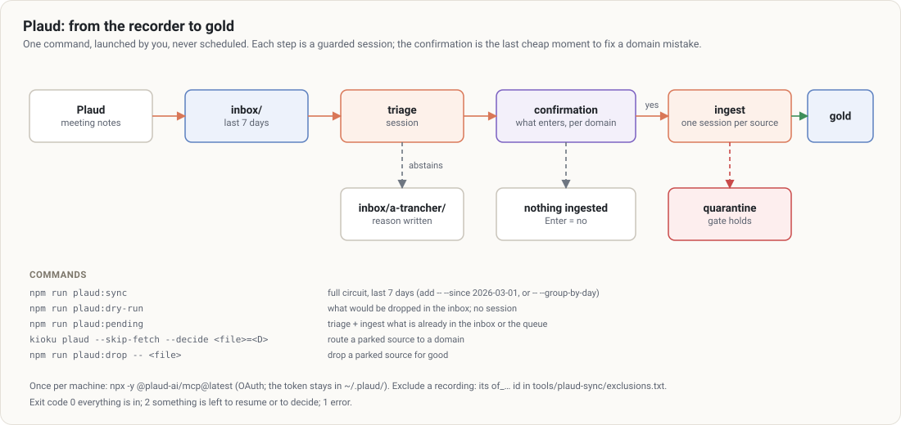

# 8. Plaud

[← Contents](README.md)

An optional module (`modules.plaud` in `kioku.config.json`, set by `kioku init --plaud`). It brings the notes of a Plaud recorder into the vault, in one command.



## Once per machine

```bash
npx -y @plaud-ai/mcp@latest      # OAuth in the browser; the token stays in ~/.plaud/
```

The circuit never reads a token itself: authentication is delegated to the official MCP.

## The circuit

1. **Drop**: Plaud notes from the last 7 days go to `inbox/` (already seen or excluded ones are skipped).
2. **Triage**: a triage session files them in `raw/<D>/`, or parks them in `inbox/a-trancher/` with a written reason.
3. **Confirmation**: the list of what is about to enter gold, **per domain**, waits for a "yes" (Enter = no).
4. **Ingestion**: one ingest session per source (or per day with `--group-by-day`), gate included.
5. **Report**: ingested / not in (to resume) / to route / to decide (quarantine).

**The confirmation at step 3 is the last moment** a domain mistake is cheap to fix: after it, the source is in the wrong domain's wiki.

Launched **by you, never scheduled**, from the vault's main checkout (`inbox/` is not versioned; refused in a worktree unless `--allow-worktree`).

## Commands

| Command | Effect |
|---|---|
| `npm run plaud:sync` | full circuit, last 7 days |
| `npm run plaud:sync -- --since 2026-03-01` | since a date |
| `npm run plaud:dry-run` | shows what would be dropped; no session |
| `npm run plaud:pending` | triage + ingest what is already in the inbox or the queue (`--skip-fetch`) |
| `npm run plaud:sync -- --group-by-day` | one session per day and per domain: meetings of the same day cross-check |
| `npm run plaud:sync -- --skip <id>` | drop a recording for good |
| `npm run plaud:sync -- --yes` | ingest without asking (required without a terminal) |

## Parked sources (`inbox/a-trancher/`)

Triage abstains in the slightest doubt. Read `inbox/a-trancher/_raisons.md` and the files **in your editor**, outside any session (no `query` session reads the inbox). Then:

| Outcome | Command |
|---|---|
| route to a domain | `kioku plaud --skip-fetch --decide <file>=<D>` |
| drop for good | `npm run plaud:drop -- <file>` |
| leave for later | nothing |

## Excluding a recording at the source

Add its `of_…` id to `tools/plaud-sync/exclusions.txt`, with a comment: it will never be dropped.

## Exit codes

`0` everything is filed and ingested; `2` sources are left to resume or to route; `1` error.
