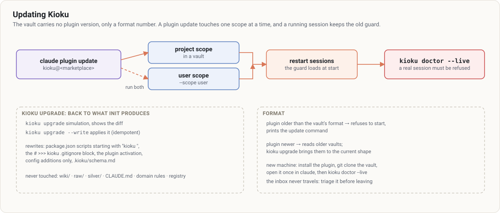

# 9. Updating Kioku

[← Contents](README.md)



## The plugin

The vault carries no plugin version, only a **format number** (`format` in `kioku.config.json`).

```bash
claude plugin update kioku@<marketplace>                 # updates ONE scope (project, when run in a vault)
claude plugin update kioku@<marketplace> --scope user    # the user scope, do it too
```

Then **restart your sessions**: the guard loads at startup, an open session keeps the old one.

Check:

```bash
kioku doctor --live          # the loaded guard does refuse a read into another domain
```

- A plugin **too old** for the vault's format refuses to start and prints the update command.
- A **newer** plugin reads older vaults; `kioku upgrade` brings them to the current shape.
- With the marketplace's auto-update on (`/plugin` › Marketplaces), updates arrive on their own, at their own pace.

## `kioku upgrade`

Brings the vault back to what `kioku init` produces today, without touching your data.

```bash
kioku upgrade            # simulation: shows the diff
kioku upgrade --write    # applies it (idempotent)
```

| File | What is rewritten |
|---|---|
| `package.json` | scripts whose value starts with `kioku `; your other scripts stay |
| `.gitignore` | the `# >>> kioku` … `# <<< kioku` block |
| `.claude/settings.json` | the plugin activation |
| `kioku.config.json` | additions only (`format`, `default_session`, `modules`) |
| `.kioku/schema.md` | the whole file |

Never touched: `wiki/`, `raw/`, `silver/`, `CLAUDE.md`, `domains/*/rules.md`, the organisation registry.

## Adding a domain

```bash
npm run setup
> /kioku:add-domain club
```

Or from a terminal: `kioku add-domain club --preset minimal --description "The sports club"`. The domain is created without touching the others, the configuration is written last, then isolation is proven on every domain. Rules (`domains/club/rules.md`) are adapted by hand, outside any session. Removing or renaming a domain is done by hand, then `kioku doctor`.

## A new machine

1. Install the plugin (README), and the `kioku` relay in your PATH if you start sessions from a terminal.
2. `git clone <private remote> <folder>`: configuration, rules and registry come with the vault.
3. `cd <folder> && claude`, trust the folder, `/exit`; then `kioku doctor --live`.

**The inbox doesn't travel** (`inbox/` is not versioned): triage it before leaving the old machine.

## The log

`wiki/<D>/log.md` keeps the current month only. The lint proposes moving past months to `wiki/<D>/log/<YYYY-MM>.md` (`kioku rotate-log <D>`); you approve. Entries are moved byte for byte.
