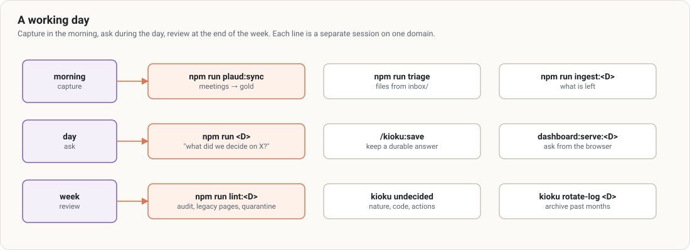

# Kioku user guide

*1 min 44 s presentation with voice-over: [watch the video (MP4)](media/kioku-explainer-en.mp4) · [subtitles](media/kioku-explainer-en.srt). Reproducible source: [tools/dashboard/video/](../../tools/dashboard/video/README.md), rendered with the `motion-studio` plugin.*

This guide covers **day-to-day** use of a Kioku vault: opening a session, bringing a source in, querying the wiki, reviewing and deciding, updating. Installing Kioku and creating a vault are in the [README](../../README.md); this guide starts from a vault that exists and whose `kioku doctor` passes.

Examples use two fictitious domains, `work` and `home`. Replace them with the ones in your `kioku.config.json`.

## Pages

| Page | For |
|---|---|
| [1. Concepts](01-concepts.md) | the medallion, domains, the guard and the gate, on one page |
| [2. Sessions](02-sessions.md) | opening the vault on one domain and one mode; what each mode sees |
| [3. Bringing a source in](03-ingest.md) | the inbox, triage, ingestion from bronze to silver to gold |
| [4. The gate](04-gate.md) | `check`, reviewer, `promote`; what passes, what is held |
| [5. Querying the wiki](05-query.md) | asking a question, filing a synthesis |
| [6. Reviewing and deciding](06-lint-quarantine.md) | the lint, the quarantine, decisions |
| [7. Dashboard](07-dashboard.md) | the state of the vault in a local browser |
| [8. Capture modules](08-capture.md) | Plaud (meetings) and Mail (Gmail threads): one circuit from the source to the wiki |
| [9. Updating Kioku](09-update.md) | a new plugin version, `kioku upgrade`, a new machine |
| [10. Troubleshooting](10-troubleshooting.md) | a guard refusal, a gate that blocks, a plugin that won't start |
| [Cheat sheet](cheat-sheet.md) | every command on one page |

## Three rules to keep in mind

1. **One session, one domain.** To switch from `work` to `home`, close and relaunch. The guard holds this, not an instruction.
2. **Only gold is read.** A question the wiki can't answer is a source to ingest, never a search in the raw files.
3. **Nothing enters gold without the gate.** Neither you nor the session writes a page straight under `wiki/`.

## Diagrams

The diagrams are generated by [`media/diagrams/build.mjs`](media/diagrams/build.mjs) (Node, no dependency): edit a declaration, then `node docs/guide/media/diagrams/build.mjs`.
